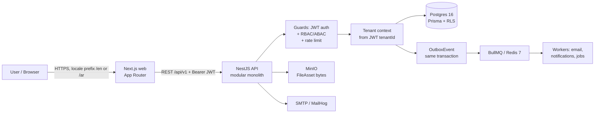
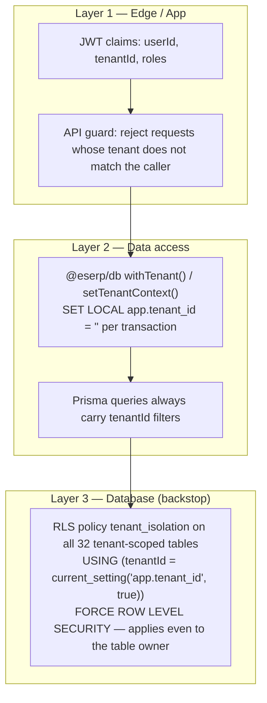

# EsERP Architecture

EsERP is a **multi-tenant, cloud-native SMB ERP**. Phase 0 (Foundation)
establishes the platform every later phase builds on. The first country
pack is **Saudi Arabia**: Saudi chart of accounts, 15% VAT, Arabic/English
with full RTL.

## Principles

1. **Modular monolith first.** One NestJS API, one Next.js web app, one
   Postgres database. Modules are separated by clear boundaries (auth,
   tenants, settings, accounting, …) so a module can be extracted to a
   service later without a rewrite. No microservices in Phase 0.
2. **Tenant isolation is enforced twice.** The API always scopes queries
   to the tenant from the JWT claim, *and* Postgres Row-Level Security
   (RLS) rejects any row whose `tenantId` does not match the session's
   `app.tenant_id`. A bug that forgets a filter cannot leak another
   tenant's data.
3. **Money is integer minor units + currency code, never floats.**
   `Money` (`@eserp/shared`) wraps a `bigint` amount in minor units
   (halalas for SAR, cents for USD) with an ISO 4217 code. Rates and
   conversions are rational (`rateNumerator` / `rateDenominator`), tax
   rates are basis points (`rateBps`, 1500 = 15%). Rounding is half-up
   on the exact rational result.
4. **Everything auditable.** Every mutation writes an `AuditLog` row
   (actor, action, entity, before/after JSON). Audit rows are
   append-only: the API never updates or deletes them.
5. **Async work goes through the outbox, not direct calls.** A database
   write and its side effects (email, notifications, downstream jobs)
   are committed atomically via `OutboxEvent` rows, which a worker
   publishes to BullMQ/Redis. No dual-write problem.

## Components

| Component | Technology | Role |
| --- | --- | --- |
| Web | Next.js 15 App Router, React 19, Tailwind 3, next-intl | Bilingual (en/ar) UI, RTL-first. Consumes `@eserp/ui`, `@eserp/i18n`, `@eserp/shared`. |
| API | NestJS (modular monolith), TypeScript strict | REST `/api/v1`, JWT auth, RBAC/ABAC guards, rate limiting, validation via Zod DTOs from `@eserp/shared`. |
| Database | PostgreSQL 16 + Prisma 6 | Single schema, RLS per tenant, migrations in `packages/db/prisma/migrations`. |
| Queue | Redis 7 + BullMQ | Background jobs (email, outbox publishing, reports). |
| Files | MinIO (S3-compatible) | `FileAsset` metadata in Postgres, bytes in S3. Presigned uploads. |
| Mail | SMTP (MailHog locally) | Transactional mail: invitations, password reset, notifications. |

## Request flow



## Tenant isolation layers



Key facts:

- `Tenant` itself is the tenant registry and is **not** tenant-scoped.
- `Permission` is a **global catalog** (seeded once, `name` unique) and
  is not tenant-scoped; `RolePermission` carries the `tenantId` instead.
- The API opens every request inside `withTenant(tenantId, …)` so the
  RLS session variable is set per transaction (`SET LOCAL`), never
  globally on a pooled connection.
- Cross-tenant access is impossible by construction at layer 3 even if
  layers 1–2 have a bug; layers 1–2 exist so the failure mode is a clean
  403/empty result, not a database error.

## RBAC / ABAC

- **Roles** are per tenant (`Role`, system roles seeded: OWNER, ADMIN,
  ACCOUNTANT, SALES, PURCHASING, WAREHOUSE, HR, VIEWER).
- **Permissions** are global strings of the form `module:action`
  (`sales:manage`, `accounting:read`, …) defined in `@eserp/shared`.
- **Assignment** is `UserRole` (user ↔ role) and `RolePermission`
  (role ↔ permission, tenant-scoped).
- Guards check the JWT's roles/permissions (RBAC) and, where the
  resource demands it, attributes of the caller and the resource
  (ABAC — e.g. a branch or warehouse scope). Permission checks happen
  in the API guard layer, before any data access.
- The seed (`packages/db/prisma/seed.ts`) creates the system roles from
  the matrix in `@eserp/shared` (`ROLE_PERMISSION_MATRIX`).

## Data & money conventions

- Every table: `id String @id @default(uuid(7))` (time-ordered UUIDv7).
- Every tenant-scoped table: `tenantId`, `createdAt`, `updatedAt`,
  `createdBy`, and a `@@index([tenantId])`.
- Money: `BigInt` minor units + currency code column; never `Float` or
  `Decimal` for amounts. Exchange rates and UoM conversions are
  rational numerator/denominator pairs. Tax rates are integer basis
  points.
- Quantities are also integer minor units (`BigInt`).
- Dates: UTC in the database; the tenant's `calendarType`
  (`gregorian` | `hijri`) and `fiscalYearStartMonth` govern display and
  fiscal periods. The demo tenant uses Gregorian, fiscal year from
  January.
- JSON columns (`AuditLog.before/after`, `OnboardingState.stepsCompleted`,
  `OutboxEvent.payload`) hold schemaless snapshots, never money.

## Outbox pattern

1. A service method writes its business rows **and** an `OutboxEvent`
   row in the same Prisma transaction (via `withTenant`).
2. A BullMQ worker polls unpublished `OutboxEvent` rows
   (`publishedAt IS NULL`, indexed), publishes them to their queue /
   handler, then stamps `publishedAt`.
3. Consumers are idempotent on `OutboxEvent.id` (at-least-once delivery).
4. If the worker is down, events accumulate safely in Postgres — no
   work is lost and no partial state is visible.

## Repository layout

```
eserp/
├── apps/
│   ├── api/                  # NestJS modular monolith (port 3001)
│   └── web/                  # Next.js 15 App Router (port 3000)
├── packages/
│   ├── db/                   # Prisma schema, migrations, RLS, seed
│   │   └── prisma/
│   │       ├── schema.prisma
│   │       ├── rls.sql               # tenant_isolation policies
│   │       ├── migrations/           # 0001_init, 0002_rls
│   │       ├── data/saudi-coa.json   # Saudi chart of accounts template
│   │       └── seed.ts               # demo tenant alsafa-trading
│   ├── shared/               # Money, Zod DTOs, roles/permissions, errors
│   ├── i18n/                 # en/ar dictionaries, RTL helpers
│   └── ui/                   # shadcn-style primitives, Tailwind tokens
├── infra/docker/             # Dockerfile.api, Dockerfile.web
├── docs/                     # architecture, ERD, security
├── docker-compose.yml        # postgres, redis, minio, mailhog, api, web
├── package.json              # turbo scripts (dev/build/lint/test/typecheck)
├── pnpm-workspace.yaml
├── turbo.json
└── tsconfig.base.json
```

## Phase 0 scope

Foundation only: monorepo + workspaces, auth (JWT + refresh rotation,
TOTP MFA, OAuth Google/Microsoft), tenants + RLS, RBAC, audit log,
settings (company profile, currencies, exchange rates, tax rates, UoM,
numbering series, warehouses, branches), i18n/RTL, onboarding wizard
(7 steps), file assets (MinIO presigned upload), notifications,
invitations, outbox. See `docs/erd-phase0.md` for the data model and
`docs/security.md` for the security posture.

Phase 1 will add master data usage: contacts, products, warehouses /
stock, chart-of-accounts postings, and employees — on top of the
Phase 0 tables, not instead of them.
