# EsERP Phase 0 — ERD

Source of truth: `packages/db/prisma/schema.prisma` (migrations
`0001_init`, `0002_rls`; RLS policies in `packages/db/prisma/rls.sql`).
Conventions: every table's `id` is `String @id @default(uuid(7))`; every
tenant-scoped table carries `tenantId`, `createdAt`, `updatedAt`,
`createdBy` and a `@@index([tenantId])`. Money is integer minor units
(`BigInt`) + currency code — never floats.

```mermaid
erDiagram
  Tenant ||--o{ User : has
  Tenant ||--o{ Role : has
  Tenant ||--o| CompanyProfile : has
  Tenant ||--o| OnboardingState : has
  Tenant ||--o{ Currency : has
  Tenant ||--o{ ExchangeRate : has
  Tenant ||--o{ TaxRate : has
  Tenant ||--o{ UnitOfMeasure : has
  Tenant ||--o{ UomConversion : has
  Tenant ||--o{ NumberingSeries : has
  Tenant ||--o{ Warehouse : has
  Tenant ||--o{ Branch : has
  Tenant ||--o{ ChartOfAccounts : has
  Tenant ||--o{ Notification : has
  Tenant ||--o{ Invitation : has
  Tenant ||--o{ FileAsset : has
  Tenant ||--o{ OutboxEvent : has
  Tenant ||--o{ AuditLog : has
  Tenant ||--o{ RefreshToken : has
  Tenant ||--o{ MfaSecret : has
  Tenant ||--o{ RolePermission : has
  Tenant ||--o{ UserRole : has

  User ||--o{ UserRole : assigned
  Role ||--o{ UserRole : assigned
  Role ||--o{ RolePermission : grants
  Permission ||--o{ RolePermission : granted_by
  User ||--o{ RefreshToken : holds
  User ||--o| MfaSecret : has
  User ||--o{ AuditLog : performs
  User ||--o{ Invitation : invites
  UnitOfMeasure ||--o{ UomConversion : converts_from
  UnitOfMeasure ||--o{ UomConversion : converts_to
  ChartOfAccounts ||--o{ ChartOfAccounts : parent_of

  Tenant {
    string id PK
    string name
    string slug UK
    string defaultCurrency "SAR"
    string defaultLocale "ar"
    int fiscalYearStartMonth
    string calendarType "gregorian|hijri"
    string status
  }
  User {
    string id PK
    string tenantId FK
    string email
    string passwordHash "argon2, nullable (OAuth users)"
    string oauthProvider "nullable"
    string oauthSubject "nullable"
    boolean mfaEnabled
    string locale
    boolean isActive
  }
  Role {
    string id PK
    string tenantId FK
    string name
    boolean isSystem
  }
  Permission {
    string id PK
    string name UK "global catalog, e.g. sales:manage"
    string module
    string action
  }
  RolePermission {
    string id PK
    string tenantId FK
    string roleId FK
    string permissionId FK
  }
  UserRole {
    string id PK
    string tenantId FK
    string userId FK
    string roleId FK
  }
  RefreshToken {
    string id PK
    string tenantId FK
    string userId FK
    string tokenHash "hashed, rotate on use"
    datetime expiresAt
    datetime revokedAt "nullable"
  }
  MfaSecret {
    string id PK
    string tenantId FK
    string userId FK "unique"
    string secret "TOTP, encrypted at rest"
  }
  AuditLog {
    string id PK
    string tenantId FK
    string actorId FK "nullable, SET NULL on user delete"
    string action
    string entityType
    string entityId "nullable"
    json before "nullable"
    json after "nullable"
    string ipAddress "nullable"
    string userAgent "nullable"
  }
  CompanyProfile {
    string id PK
    string tenantId FK "unique"
    string legalName "nullable"
    string taxNumber "nullable"
    string commercialRegistration "nullable"
    string country "SA"
    string logoFileId "nullable"
  }
  Currency {
    string id PK
    string tenantId FK
    string code "SAR/USD/EUR/AED"
    boolean isDefault
  }
  ExchangeRate {
    string id PK
    string tenantId FK
    string fromCurrencyCode
    string toCurrencyCode
    bigint rateNumerator
    bigint rateDenominator "default 1"
    datetime effectiveDate
  }
  TaxRate {
    string id PK
    string tenantId FK
    string name
    int rateBps "1500 = 15% VAT"
    string type "standard|zero_rated|exempt"
    boolean isInclusive
    boolean isDefault
  }
  UnitOfMeasure {
    string id PK
    string tenantId FK
    string code
    string baseUnitCode "nullable"
  }
  UomConversion {
    string id PK
    string tenantId FK
    string fromUomId FK
    string toUomId FK
    bigint factorNumerator
    bigint factorDenominator "default 1"
  }
  NumberingSeries {
    string id PK
    string tenantId FK
    string code
    string pattern
    int nextNumber
  }
  Warehouse {
    string id PK
    string tenantId FK
    string code "nullable, unique per tenant when set"
    boolean isDefault
  }
  Branch {
    string id PK
    string tenantId FK
    string code "nullable, unique per tenant when set"
    boolean isDefault
  }
  ChartOfAccounts {
    string id PK
    string tenantId FK
    string code
    string nameAr
    string nameEn
    string type
    string parentId FK "nullable, self-referencing"
    boolean isSystem
  }
  Notification {
    string id PK
    string tenantId FK
    string userId "nullable (tenant-wide)"
    string type "info|..."
    datetime readAt "nullable"
  }
  Invitation {
    string id PK
    string tenantId FK
    string email
    string roleNames "string[]"
    string tokenHash
    string invitedById FK "nullable"
    datetime acceptedAt "nullable"
    datetime expiresAt
  }
  OnboardingState {
    string id PK
    string tenantId FK "unique"
    int currentStep "0..6"
    json stepsCompleted
    datetime completedAt "nullable"
  }
  FileAsset {
    string id PK
    string tenantId FK
    string fileName
    string contentType
    bigint sizeBytes
    string storageKey
    string bucket
  }
  OutboxEvent {
    string id PK
    string tenantId FK
    string eventType
    string aggregateId "nullable"
    json payload
    datetime publishedAt "nullable"
  }
```

## Constraints, indexes, and RLS per table

RLS policy (all tenant-scoped tables): `tenant_isolation`
`USING ("tenantId" = current_setting('app.tenant_id', true))`
`WITH CHECK ("tenantId" = current_setting('app.tenant_id', true))`,
with `FORCE ROW LEVEL SECURITY` — it applies even to the table owner.
`Tenant` (registry) and `Permission` (global catalog) have **no** RLS.

| Table | Key constraints | Indexes | RLS |
| --- | --- | --- | --- |
| Tenant | PK `id`; UK `slug` | — | none (registry) |
| User | PK `id`; UK `(email, tenantId)`; FK `tenantId → Tenant` (Cascade) | `tenantId`, `(oauthProvider, oauthSubject)` | `tenant_isolation` |
| Role | PK `id`; UK `(name, tenantId)`; FK `tenantId → Tenant` (Cascade) | `tenantId` | `tenant_isolation` |
| Permission | PK `id`; UK `name` (global) | `module` | none (global catalog) |
| RolePermission | PK `id`; UK `(roleId, permissionId)`; FKs → Role, Permission (Cascade) | `tenantId`, `roleId` | `tenant_isolation` |
| UserRole | PK `id`; UK `(userId, roleId)`; FKs → User, Role (Cascade) | `tenantId`, `userId` | `tenant_isolation` |
| RefreshToken | PK `id`; FK `userId → User` (Cascade) | `tenantId`, `userId` | `tenant_isolation` |
| MfaSecret | PK `id`; UK `userId`; FK `userId → User` (Cascade) | `tenantId` | `tenant_isolation` |
| AuditLog | PK `id`; FK `actorId → User` (SetNull) | `tenantId`, `(entityType, entityId)`, `actorId`, `createdAt` | `tenant_isolation` |
| CompanyProfile | PK `id`; UK `tenantId`; FK `tenantId → Tenant` (Cascade) | `tenantId` | `tenant_isolation` |
| Currency | PK `id`; UK `(code, tenantId)` | `tenantId` | `tenant_isolation` |
| ExchangeRate | PK `id`; UK `(fromCurrencyCode, toCurrencyCode, effectiveDate, tenantId)` | `tenantId` | `tenant_isolation` |
| TaxRate | PK `id`; UK `(name, tenantId)` | `tenantId` | `tenant_isolation` |
| UnitOfMeasure | PK `id`; UK `(code, tenantId)` | `tenantId` | `tenant_isolation` |
| UomConversion | PK `id`; UK `(fromUomId, toUomId, tenantId)`; FKs → UnitOfMeasure (Cascade) | `tenantId` | `tenant_isolation` |
| NumberingSeries | PK `id`; UK `(code, tenantId)` | `tenantId` | `tenant_isolation` |
| Warehouse | PK `id`; UK `(code, tenantId)` | `tenantId` | `tenant_isolation` |
| Branch | PK `id`; UK `(code, tenantId)` | `tenantId` | `tenant_isolation` |
| ChartOfAccounts | PK `id`; UK `(code, tenantId)`; FK `parentId → ChartOfAccounts` (SetNull, self-ref) | `tenantId`, `parentId` | `tenant_isolation` |
| Notification | PK `id` | `tenantId`, `userId` | `tenant_isolation` |
| Invitation | PK `id`; UK `(email, tenantId)`; FK `invitedById → User` (SetNull) | `tenantId` | `tenant_isolation` |
| OnboardingState | PK `id`; UK `tenantId` | `tenantId` | `tenant_isolation` |
| FileAsset | PK `id` | `tenantId`, `storageKey` | `tenant_isolation` |
| OutboxEvent | PK `id` | `tenantId`, `publishedAt`, `eventType` | `tenant_isolation` |

Notes:

- `Warehouse.code` / `Branch.code` are nullable; the unique index treats
  `NULL` as distinct in Postgres, so multiple code-less rows are allowed
  while a code can only be used once per tenant.
- `AuditLog` has no `updatedAt` semantics in practice — rows are
  append-only (see `docs/security.md`); `updatedAt` exists only because
  the base convention adds it to every model.
- `OnboardingState.currentStep` is 0–6; step payloads are validated in
  `@eserp/shared` (`onboardingStepData`: 0 company profile, 1 fiscal /
  calendar, 2 CoA template, 3 taxes, 4 warehouse, 5 invites, 6 CSV import).
- `ExchangeRate` / `UomConversion` store rational values
  (numerator/denominator `BigInt`); `TaxRate.rateBps` is integer basis
  points. No float columns exist anywhere in the schema.
