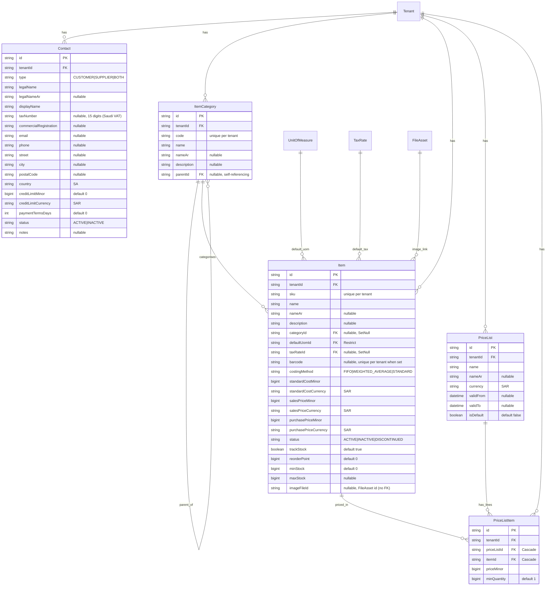

# EsERP Phase 1 — Master Data ERD

Source of truth: `packages/db/prisma/schema.prisma` (migration
`0003_phase1_master_data`; RLS policies in `packages/db/prisma/rls.sql`).
Conventions as Phase 0: every table's `id` is `String @id @default(uuid(7))`;
every tenant-scoped table carries `tenantId`, `createdAt`, `updatedAt`,
`createdBy` and a `@@index([tenantId])`. Money is integer minor units
(`BigInt`) + currency code — never floats. Quantities are `BigInt` minor
units too.

## New tables

## Constraints, indexes, and RLS per table

RLS policy (all five tables): `tenant_isolation`
`USING ("tenantId" = current_setting('app.tenant_id', true) OR
current_setting('app.bootstrap', true) = 'eserp-login')` with the same
`WITH CHECK`, plus `FORCE ROW LEVEL SECURITY` — identical to Phase 0
(see `packages/db/prisma/rls.sql` and migration `0003_phase1_master_data`).

| Table | Key constraints | Indexes | RLS |
| --- | --- | --- | --- |
| Contact | PK `id`; UK `(taxNumber, tenantId)`; UK `(email, tenantId)` | `tenantId`, `type`, `status` | `tenant_isolation` |
| ItemCategory | PK `id`; UK `(code, tenantId)`; FK `parentId → ItemCategory` (SetNull, self-ref) | `tenantId`, `parentId` | `tenant_isolation` |
| Item | PK `id`; UK `(sku, tenantId)`; UK `(barcode, tenantId)`; FK `categoryId → ItemCategory` (SetNull), `defaultUomId → UnitOfMeasure` (Restrict), `taxRateId → TaxRate` (SetNull) | `tenantId`, `categoryId`, `status` | `tenant_isolation` |
| PriceList | PK `id` | `tenantId`, `isDefault` | `tenant_isolation` |
| PriceListItem | PK `id`; UK `(priceListId, itemId, minQuantity)`; FKs → PriceList, Item (Cascade) | `tenantId`, `priceListId`, `itemId` | `tenant_isolation` |

Notes:

- `Contact.taxNumber` / `email` are nullable; Postgres treats `NULL` as
  distinct in a unique index, so many contacts may omit them while a
  value can only be used once per tenant. The same applies to
  `Item.barcode`.
- `Item.defaultUomId` is `Restrict`: a unit of measure in use by an item
  cannot be deleted. `categoryId` / `taxRateId` are `SetNull` so removing
  a category or tax rate does not delete items.
- `Item.imageFileId` is a plain string holding a `FileAsset` id — there is
  deliberately no foreign key and no new file logic in Phase 1; the
  existing presigned-upload flow creates the asset.
- `PriceListItem.minQuantity` is part of the unique key, so one price list
  can hold quantity-break prices for the same item (e.g. 1+ @ 34.99,
  12+ @ 32.99). Sales/Purchasing phases consume these rows.
- One contact can be both customer and supplier (`type = BOTH`); there is
  no separate customer/supplier table.
- `Item.costingMethod`, `reorderPoint`, `minStock`/`maxStock` are stored
  now and used by the Inventory phase later; nothing in Phase 1 computes
  stock or cost from them.

## API

| Resource | Endpoints (`/api/v1`) | Permissions |
| --- | --- | --- |
| Contacts | `GET /contacts` (search, `type`, `status`), `GET /contacts/:id`, `POST /contacts`, `PATCH /contacts/:id`, `DELETE /contacts/:id`, `POST /contacts/import/preview` | `contacts:read` / `contacts:manage` |
| Item categories | `GET /item-categories`, `GET /item-categories/:id`, `POST /item-categories`, `PATCH /item-categories/:id`, `DELETE /item-categories/:id` | `items:read` / `items:manage` |
| Items | `GET /items` (search, `categoryId`, `status`, `costingMethod`), `GET /items/:id`, `POST /items`, `PATCH /items/:id`, `DELETE /items/:id`, `POST /items/import/preview` | `items:read` / `items:manage` |
| Price lists | `GET /pricelists`, `GET /pricelists/:id`, `POST /pricelists`, `PATCH /pricelists/:id`, `DELETE /pricelists/:id`, `POST /pricelists/:id/items`, `DELETE /pricelists/:id/items/:lineId` | `pricelists:read` / `pricelists:manage` |

All list endpoints return `{ data, meta: { total, page, pageSize, totalPages } }`.
Money/quantity inputs and outputs are integer minor units (JSON numbers);
the API converts to `BigInt` before writing and back to numbers when
serialising (see `apps/api/src/modules/master-data/serialize.ts`).
Every mutation writes an `AuditLog` row and an `OutboxEvent` row in the
same transaction (`contact.created`, `item.created`, `pricelist.created`, …).

### Permissions (added to `ROLE_PERMISSION_MATRIX`)

New permissions: `items:read`, `items:manage`, `item-categories:read`,
`item-categories:manage`, `pricelists:read`, `pricelists:manage`
(`contacts:*` already existed in Phase 0).

| Role | Master-data access |
| --- | --- |
| OWNER / ADMIN | everything |
| ACCOUNTANT | `contacts:read`, `items:read`, `pricelists:read` |
| SALES | `contacts:*`, `items:read`, `pricelists:read` |
| PURCHASING | `contacts:*`, `items:read` + `items:manage`, `pricelists:read` |
| WAREHOUSE | `items:read` |
| HR | none |
| VIEWER | `*:read` (all read permissions) |

## CSV import preview

`POST /contacts/import/preview` and `POST /items/import/preview` accept
`{ csvText }` and return `{ rows, valid, errors: [{ row, message }],
preview }` (first 10 valid rows). Rows are validated with the same Zod
DTOs as the create endpoints; invalid rows are reported, never persisted.
There is deliberately no import-commit endpoint in Phase 1 — preview only.

## Assumptions made

1. **Type/status/costing-method are stored as plain strings**, not
   Postgres enums — the same convention Phase 0 uses for `TaxRate.type`,
   `ChartOfAccounts.type`, etc. Validation lives in the shared Zod DTOs.
2. **One default price list per tenant is enforced in the service**
   (creating/updating a list with `isDefault: true` clears the flag on
   the others); there is no partial unique index.
3. **Category delete is blocked** while the category has items or
   sub-categories, and **item delete is blocked** while the item is on a
   price list — both return 409. Deleting a price list cascade-deletes
   its lines (expected: the lines belong to the list).
4. **Zod validation errors now return 400 `VALIDATION_ERROR`** instead of
   500. This is a fix in the global exception filter
   (`apps/api/src/common/filters/http-exception.filter.ts`) that also
   covers the Phase 0 controllers; the check is structural
   (`name === 'ZodError'` + `issues` array) because `@eserp/shared`
   bundles its own zod copy and `instanceof` fails across the package
   boundary.
5. **Contact address is flat columns** (`street`/`city`/`postalCode`/
   `country`), matching the `CompanyProfile` pattern, not a nested
   JSON object.

## Known limitations

- No import-commit endpoint (preview only); no bulk create/update.
- No stock quantities yet — `trackStock` / `reorderPoint` / `minStock` /
  `maxStock` are stored, not enforced; the Inventory phase adds stock.
- No price-list effective-date enforcement at read time (`validFrom` /
  `validTo` are stored and validated for ordering only); Sales/
  Purchasing phases decide which list applies.
- No item image upload UI — `imageFileId` can be set via the API only.
- Category trees are returned flat (with `parentId`); the UI does not
  render a tree view.
