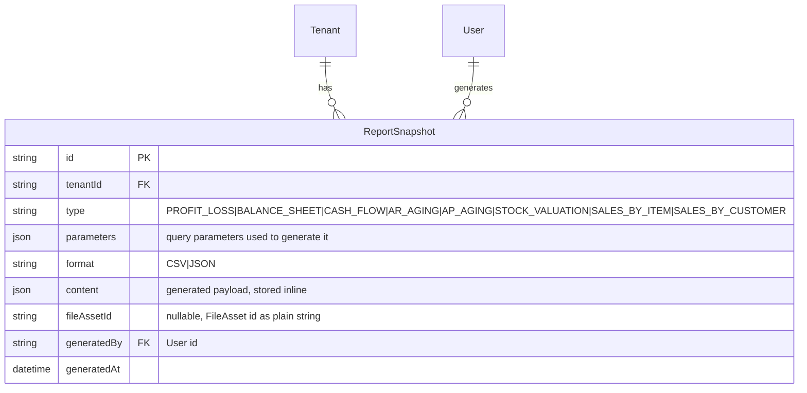

# EsERP Phase 10 — Analytics / AI ERD

Source of truth: `packages/db/prisma/schema.prisma` (migration
`0012_phase10_analytics`; RLS policies in
`packages/db/prisma/rls.sql`). Conventions as Phase 0–9: every
table's `id` is `String @id @default(uuid(7))`; every tenant-scoped
table carries `tenantId`, `createdAt`, `updatedAt`, `createdBy` and a
`@@index([tenantId])`. Money is integer minor units (`BigInt`) +
currency code — never floats. All statement math is half-up integer
math (`packages/shared/src/analytics.ts`).

## New tables

Phase 10 adds exactly one table. All KPIs and statements are computed
on read from the existing ledger, sales, inventory, purchasing and
payroll data — nothing is denormalised.



## Dashboard KPIs (`GET /analytics/dashboard`)

Computed from real data only — no mocked numbers anywhere. Read-only
(no audit rows), cached in Redis for 60s per tenant
(`eserp:analytics:{tenantId}:{key}`); the cache is best-effort, so a
down Redis never fails the request.

| KPI | Derivation |
| --- | --- |
| Revenue (current month) + previous month + trend | Σ net credit of `REVENUE` accounts from posted journal lines in the month; `trendBps` = (current − previous) ÷ previous in basis points |
| Gross profit + margin | `computeProfitLoss`: revenue − COGS; margin in bps, null when revenue is 0 |
| Open AR / AP + overdue amounts | Σ (invoice total − paid) for open invoices; overdue = due date < now |
| Stock value | Σ `qtyOnHand × averageCost` over stock levels |
| Sales by month (last 12) | Revenue from posted ledger lines, grouped by month |
| Top 5 customers / items by revenue | From posted sales invoices / lines |
| Low-stock count | Items with `qtyOnHand ≤ reorderPoint` |
| Open POs value | Σ `(quantityOrdered − quantityReceived) × unitCostMinor` for open purchase orders |
| Payroll cost (current month) | Gross of the payroll run for the month (0 when none) |

## Financial statements

All derived from `JournalEntry` lines grouped by CoA account type.
Only `POSTED`/`REVERSED` lines count. The Phase 2 trial balance is
reused — it is not rebuilt.

### Profit & Loss (`GET /analytics/profit-loss`)

`packages/shared/src/analytics.ts` — `computeProfitLoss`:

- **Revenue** = net credit of `REVENUE` accounts.
- **COGS = CoA account 5010 only.** This is the conservative,
  spec-implied choice: 5010 is the single cost-of-goods account in
  the Saudi CoA; other `EXPENSE` accounts are operating expenses.
- **Operating expenses** = net debit of all other `EXPENSE` accounts.
- **Gross profit** = revenue − COGS; **net income** = gross profit −
  operating expenses; margins in basis points, null when revenue is 0.
- Scoped by fiscal period (dates) or an explicit `from`/`to` range;
  default is current year-to-date.

### Balance Sheet (`GET /analytics/balance-sheet`)

`computeBalanceSheet`, as of a date:

- **Assets** = net debit of `ASSET` accounts; **liabilities** =
  net credit of `LIABILITY` accounts; **equity** = net credit of
  `EQUITY` accounts **plus YTD net income**.
- Opening balances for the fiscal year of `asOf` plus posted
  movements ≤ `asOf`. The response reports `balanced` and
  `differenceMinor` (assets − (liabilities + equity)); a non-zero
  difference is reported, never silently forced to zero.

### Cash Flow (`GET /analytics/cash-flow`)

`computeCashFlow` — simple indirect presentation from bank/cash
account movements (documented method):

- **Operating** = net income adjusted by the change in non-cash
  working-capital accounts (receivables, payables, inventory).
- **Investing** = change in fixed assets (CoA `14xx`).
- **Financing** = change in equity excluding net income, plus loans
  (`23xx`/`24xx`).
- **Cash** = CoA accounts `1010 + 1020 + 1030`. The statement
  reconciles: `netChangeInCash` must equal the actual change in cash
  over the period; `balanced` and `differenceMinor` are reported.

## AR / AP aging

Reuses the Phase 3 helpers `agingBucket(daysPastDue(...))` from
`packages/shared/src/sales.ts` — buckets `CURRENT | D1_30 | D31_60 |
D61_90 | D90_PLUS`. The aging helpers live in `sales.ts`, not in
`analytics.ts` (no duplicate implementation).

## Exports & snapshots

- CSV export endpoints: `GET /analytics/exports/:report` for
  `profit-loss`, `balance-sheet`, `cash-flow`, `ar-aging`,
  `ap-aging`, `stock-valuation`, `sales-by-item`,
  `sales-by-customer`. Statement exports emit summary field/value
  rows; list reports emit row arrays.
- `POST /analytics/report-snapshots` saves a generated report
  (content stored inline as JSON in `ReportSnapshot.content`;
  `fileAssetId` is available for a future FileAsset link). Snapshots
  are re-downloadable as CSV or JSON
  (`GET /analytics/report-snapshots/:id/download`).

## AI insights (`apps/api/src/modules/ai/`)

**There was no Phase 0 AI interface.** A repo search found only
OAuth providers; Phase 10 itself introduces the provider seam
(`packages/shared/src/ai.ts`).

```ts
interface AiProvider {
  name: string;
  summarize(prompt: string, data: unknown): Promise<string>;
}
```

- `RuleBasedProvider` (`name: "rule-based"`) is the only shipped
  adapter: deterministic, offline, never fabricates — it echoes
  insights computed from real aggregates (`buildRuleInsights`:
  overdue invoices, low stock, margin fall/rise, payroll share of
  revenue, working capital, open POs, all-clear fallback).
- **Provider selection:** `AI_PROVIDER` set to anything other than
  `rule-based` logs a warning and falls back to `RuleBasedProvider`.
  No LLM adapter is shipped in Phase 10 and **no key is ever
  required** — the module works with zero configuration.
- Every response is labelled with its source (`rule-based` vs the
  provider name).
- `POST /ai/ask` answers **only from computed aggregates** via a
  small intent matcher (`matchIntent`, en + ar keywords; intents:
  revenue, grossProfit, ar, ap, stock, payroll, topCustomers,
  topItems, salesByMonth, unknown). For anything else it returns a
  clear "I can only answer questions about …" response listing
  `AI_ASK_TOPICS` — never a hallucinated number.

## Permissions

New permissions `analytics:read`, `reports:read`, `reports:manage`,
`ai:read`, `ai:ask` (see `packages/shared/src/types.ts`):
Owner/Admin full; Accountant full on reports/analytics + AI;
Sales read on analytics + AI; Purchasing/Warehouse read on analytics
+ `ai:read`; HR read on analytics + `ai:read`; Viewer read-only.

## Seed

One `ReportSnapshot` (`PROFIT_LOSS`, November 2026) for the demo
tenant, content computed in-seed from real posted journal lines via
`computeProfitLoss` (seeded net income −5,565,653 minor). Skipped if
a `PROFIT_LOSS` snapshot already exists, so the seed stays
idempotent. No other Phase 10 seed is needed — dashboards read what
is already there.

## Assumptions

- COGS = CoA account 5010 only (see P&L above).
- Balance sheet equity includes YTD net income; `differenceMinor`
  is reported, not forced.
- Cash flow is a simple indirect presentation from balance changes
  (see method above); it is not a transaction-level statement.
- KPI caching is Redis TTL (60s) only — no background scheduler.

## Limitations

- No LLM adapter is shipped; AI insights are rule-based only until
  a provider is added in a later phase (the `AiProvider` seam is
  ready for it).
- No multi-currency analytics documents — single currency per
  document, tenant default.
- No ZATCA e-invoicing (Phase 11).
- National ID/Iqama stored as plain string (Phase 8 limitation,
  unchanged).
