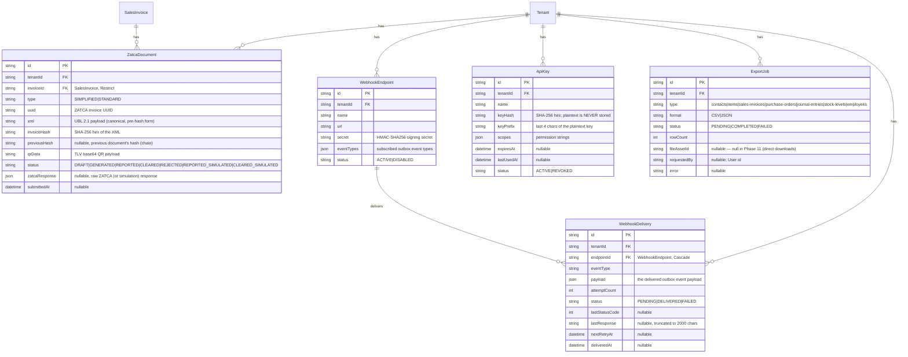
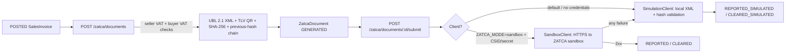

# EsERP Phase 11 — Integrations ERD

Source of truth: `packages/db/prisma/schema.prisma` (migration
`0013_phase11_integrations`; RLS policies in
`packages/db/prisma/rls.sql`). Conventions as Phase 0–10: every
table's `id` is `String @id @default(uuid(7))`; every tenant-scoped
table carries `tenantId`, `createdAt`, `updatedAt`, `createdBy` and a
`@@index([tenantId])`. Money is integer minor units (`BigInt`) +
currency code — never floats.

Phase 11 is the last build phase. It adds the external-facing surface
(ZATCA e-invoicing, webhooks, API keys, export centre, provider
mocks), the Phase 8 field-encryption hardening, and the rate limiting
that `docs/security.md` flagged as missing since Phase 0. It also
makes the Windows path first-class (`setup-windows.ps1`,
`setup-windows.bat`, `.gitattributes`; see `docs/handover.md`).

## New tables



No changes to existing tables. `Employee.nationalId` / `iban` keep
their `String?` columns — encryption is app-level (see below), so
legacy plaintext rows can be encrypted in place without a column
migration.

## ZATCA e-invoicing (`apps/api/src/modules/zatca/`)

Honest implementation, labelled everywhere it matters.

### Flow



- **Generation** (`ZatcaService.generate`): only a `POSTED` (or paid)
  invoice; the seller VAT number must be a valid 15-digit number on
  the tenant's company profile (400 otherwise); a `STANDARD` (B2B)
  document additionally needs a buyer with a valid 15-digit VAT
  number (400 otherwise). The XML is built from real invoice data by
  `buildUblXml` (`packages/shared/src/integrations.ts`):
  standards-shaped UBL 2.1 (Invoice-2 namespace, supplier/customer
  parties, tax totals, legal monetary total, invoice lines with
  per-line tax). The hash is SHA-256 of the canonical XML string as
  stored; `previousHash` is the latest non-DRAFT document's hash for
  the tenant (the chain). The QR is the ZATCA TLV encoding
  (`encodeZatcaQr`): tags 1 seller name, 2 VAT number, 3 ISO timestamp,
  4 total incl. VAT, 5 VAT amount — base64 of the concatenated TLV
  bytes. One non-REJECTED document per (invoice, type).
- **Submission**: `SimulationClient` (default) re-hashes the XML,
  checks the required UBL markers, and marks the document
  `REPORTED_SIMULATED` (SIMPLIFIED) or `CLEARED_SIMULATED`
  (STANDARD). `SandboxClient` maps ZATCA's published API shape:
  base `ZATCA_SANDBOX_URL` (default
  `https://gw-fatoora.zatca.gov.sa/e-invoicing/core`),
  SIMPLIFIED → `POST /invoices/reporting/single`,
  STANDARD → `POST /invoices/clearance/single`,
  `Accept-Version: V2`, `Authorization: Basic base64(CSID:secret)`,
  body `{ invoiceHash, uuid, invoice: base64(XML) }`, 15s timeout.
  Any transport/auth/non-2xx failure degrades to simulation and
  records `sandboxFallback: true` + the error in `zatcaResponse` —
  it never fails the request or the suite for lack of credentials.
- **Production clearance is out of scope for the code**: it needs
  real ZATCA onboarding (OTP + CCSID + production certificate) which
  only the tenant can complete. Nothing in this module claims to
  produce a certified ZATCA document; the XML is "standards-shaped",
  and every simulated status/response says so.

### Endpoints

| Method | Path | Permission |
| --- | --- | --- |
| `POST /zatca/documents` | generate from a posted invoice | `zatca:manage` |
| `POST /zatca/documents/:id/submit` | submit (simulation or sandbox) | `zatca:manage` |
| `GET /zatca/documents` | list (status/type/invoiceId filters) | `zatca:read` |
| `GET /zatca/documents/:id` | one document (XML + QR + hash + response) | `zatca:read` |

## Webhooks (`apps/api/src/modules/webhooks/`)

```mermaid
flowchart LR
  MUT[Mutation service] -->|same tx| OUT[OutboxEvent]
  OUT --> DRAIN[Outbox drain worker, every 60s]
  DRAIN -->|ACTIVE endpoint subscribed to event type| DEL[WebhookDelivery PENDING]
  DEL --> Q[BullMQ webhooks queue, attempts 5, exponential backoff 60s]
  Q --> HTTP[POST endpoint URL, X-EsERP-Signature: sha256=HMAC(secret, raw body)]
  HTTP -->|2xx| OK[DELIVERED]
  HTTP -->|fail| RETRY[PENDING, nextRetryAt] --> Q
  RETRY -->|5th failure| FAIL[FAILED]
```

- Events delivered are the outbox event types the system already
  emits: `sales-invoice.created/posted/voided`,
  `customer-payment.created`, `order.created/confirmed/cancelled`,
  `payroll-run.created/calculated/approved/paid`, `stock.low`
  (emitted once per reorder-point crossing in `StockService.issue`),
  and `ping` (test deliveries). The drain worker fans out to every ACTIVE
  endpoint whose `eventTypes` include the event type; the HTTP POST
  itself is done by `WebhooksService`'s own BullMQ worker (the queue
  is shared by name with the drain worker, so no circular module
  dependency). Deliveries are at-least-once — receivers must be
  idempotent on the delivery id in the payload.
- Signature: `X-EsERP-Signature: sha256=<hex HMAC-SHA256 of the raw
  JSON body>` using the endpoint secret (`signWebhookPayload` /
  `verifyWebhookSignature` in `webhooks.service.ts`); the request
  also carries `X-EsERP-Event` and `X-EsERP-Delivery`. Timeout 10s;
  last response truncated to 2000 chars.
- `POST /webhooks/endpoints/:id/test` sends a `ping` event (endpoint
  must be ACTIVE). Endpoints are created DISABLED by default unless
  the caller passes `status: ACTIVE`; the secret is generated
  server-side (32 random bytes, hex) when not supplied.

## API keys (`apps/api/src/modules/api-keys/`)

- Create returns the plaintext key **once** (`eserp_` + 32 hex
  chars); afterwards only the SHA-256 hash + last-4 prefix are
  stored. Scopes are permission strings, validated against
  `ALL_PERMISSIONS` at creation (400 on unknown scopes).
- Auth: `JwtAuthGuard` accepts an `X-API-Key` header instead of a
  Bearer token (no Bearer token needed). The key resolves via a
  bootstrap transaction (tenant unknown until the key resolves);
  revoked/expired/unknown keys are 401. The guard sets
  `req.permissions` = the key's scopes, so `PermissionsGuard`
  enforces exactly the same RBAC as for JWT users, and
  `req.apiKeyId` for rate limiting. `lastUsedAt` is updated
  best-effort (never fails the request).
- Rate limit per key: `API_KEY_RATE_LIMIT_MAX` / window (default
  300/min). Keys can be revoked (never un-revoked) and expire via
  `expiresAt`.

## Export centre (`apps/api/src/modules/exports/`)

- `GET /exports/:type?format=csv|json` — direct download, rows
  fetched in pages of 500 from live tenant-scoped data, CSV via the
  Phase 10 `toCsv` helper. Types: `contacts`, `items`,
  `sales-invoices`, `purchase-orders`, `journal-entries`,
  `stock-levels`, `employees`. Employee exports mask national ID /
  IBAN unless the caller has `hr:read-sensitive`, exactly like the
  HR endpoints.
- `POST /exports/jobs` records an `ExportJob` (type, format, row
  count, requester) for the same generation; jobs run synchronously
  in Phase 11 and `fileAssetId` stays null — there is no stored file
  yet, the download endpoints are the delivery path (see
  Limitations). `GET /exports/jobs` lists jobs.

## Provider interfaces + mocks (`apps/api/src/modules/providers/`)

`PaymentGateway` / `SmsProvider` (`packages/shared/src/integrations.ts`).
Only mocks ship, and every response is labelled `simulated: true`,
`provider: 'mock'`:

- `MockPaymentProvider` — deterministic charge/refund results
  (transaction id derived from the input hash, so the same input
  always yields the same id). Real Saudi gateways (Moyasar /
  HyperPay) are documented as env vars in `.env.example`
  (`MOYASAR_API_KEY`, `HYPERPAY_USER_ID` / `HYPERPAY_ENTITY_ID` /
  `HYPERPAY_ACCESS_TOKEN`); wiring a real gateway means implementing
  `PaymentGateway` against its API and selecting it when its key is
  configured. Until then the mock answers and no live charge exists.
- `MockSmsProvider` — logs the message as an outbox event
  (`sms.sent`, simulated) and returns a mock message id. No SMS is
  ever sent. Real provider: set `SMS_API_KEY` / `SMS_SENDER` and
  implement `SmsProvider`.
- `GET /providers/status` reports configured-vs-mock for payment,
  SMS, ZATCA and AI in one place (web page `/providers`).

## Field encryption — Phase 8 hardening (`packages/db/src/encryption.ts`)

- AES-256-GCM, app-level. Key from `ENCRYPTION_KEY` (64 hex chars;
  generate with `openssl rand -hex 32`). Stored format:
  `enc1:<base64(iv[12] || authTag[16] || ciphertext)>`.
- `FieldEncryptor.encrypt/decrypt` — encrypt is idempotent (an
  already-`enc1:` value passes through); decrypt passes legacy
  plaintext through unchanged, so rows written before Phase 11 keep
  working until encrypted in place. Tampered ciphertext fails GCM
  authentication and throws — never silently returns a wrong value.
  Without a key the encryptor is inert (plaintext passthrough + one
  console warning); production MUST set `ENCRYPTION_KEY`.
- Applied in the HR service layer (`employees.service.ts`): encrypt
  on create/update, decrypt-then-mask on read. API responses return
  masked values (`****1234`, `maskSensitive` in `@eserp/shared`)
  unless the caller has `hr:read-sensitive` (HR role has it; OWNER /
  ADMIN have it via `*`). Audit snapshots always carry the stored
  (encrypted) form, never plaintext. Search by national ID is no
  longer supported once values are encrypted (ciphertext is not
  searchable) — search covers code + name only.
- Existing rows: `packages/db/prisma/scripts/encrypt-employee-fields.ts`
  encrypts plaintext `nationalId` / `iban` values in place,
  idempotently (skips `enc1:` / empty). Run after migration 0013
  with the same key the API uses:
  `ENCRYPTION_KEY="<key>" DATABASE_URL="<owner-url>" npx tsx prisma/scripts/encrypt-employee-fields.ts`.
  The seed encrypts demo employees when `ENCRYPTION_KEY` is set.

## Rate limiting (`apps/api/src/common/rate-limit/`)

Closes the gap `docs/security.md` flagged since Phase 0 (no
throttler anywhere). `FixedWindowLimiter` (in-memory fixed window)
behind the global `RateLimitGuard` (registered after the auth
guards, so it can key on the authenticated tenant / API key):

- JWT requests: `tenant:<tenantId>:<ip>`, default 600/min
  (`RATE_LIMIT_MAX` / `RATE_LIMIT_WINDOW_SECONDS`).
- API-key requests: `api-key:<keyId>`, default 300/min
  (`API_KEY_RATE_LIMIT_MAX` / `API_KEY_RATE_LIMIT_WINDOW_SECONDS`).
- Public routes: `ip:<ip>` on the same 600/min budget.
- Exceeding the limit returns **429** `RATE_LIMITED` with a
  `Retry-After` header.

Limitation: the store is per-process. With a single API replica
(the Phase 0 deployment shape) that is exact; with multiple
replicas a tenant could exceed the limit by up to N×. The
documented production hardening is a Redis-backed store (Redis is
already in the stack for BullMQ).

## Permissions

New: `zatca:*`, `webhooks:*`, `api-keys:*`, `exports:*`,
`hr:read-sensitive` (in `ALL_PERMISSIONS` + `ROLE_PERMISSION_MATRIX`).

| Role | Phase 11 grants |
| --- | --- |
| OWNER / ADMIN | everything (ADMIN except `tenants:delete`); API-key management is Owner/Admin only |
| ACCOUNTANT | `zatca:*`, `exports:*`, `webhooks:read`, `api-keys:read` |
| SALES / PURCHASING / WAREHOUSE | `zatca:read`, `exports:read` |
| HR | `hr:read-sensitive` (plus `exports:read`) |
| VIEWER | read-only via `*:read` (`zatca:read`, `webhooks:read`, `api-keys:read`, `exports:read`); no `hr:read-sensitive` |

## Seed

- One demo webhook endpoint `Demo webhook (disabled)` —
  `DISABLED`, placeholder URL `https://example.com/webhooks/eserp-demo`,
  subscribed to `sales-invoice.posted` + `order.confirmed`.
- One demo API key `Demo API key (revoked)` — `REVOKED`, hash of a
  fixed demo string, prefix `0000`, scope `sales-invoices:read`.
  Both are deliberately inert so the pages are not empty but nothing
  live is created.
- Demo employees' national ID / IBAN are encrypted at rest when
  `ENCRYPTION_KEY` is set at seed time (verified: all four `EMP-00x`
  rows store `enc1:` values).

## Web UI

`/zatca-documents` (generate + submit, QR/XML/hash view),
`/webhooks` (endpoints + deliveries + test delivery),
`/api-keys` (create-once display + revoke + list),
`/exports` (download + job history), `/providers` (configured-vs-mock
status + mock charge/SMS simulators) — en/ar via next-intl, RTL, in
the sidebar under the analytics section.

## Assumptions

- ZATCA sandbox endpoint paths/headers follow ZATCA's published
  e-invoicing API spec as documented in code comments; they were not
  verified against a live ZATCA account (no credentials exist).
- The hash chain is per-tenant over non-DRAFT documents in
  creation order; REJECTED documents do not enter the chain.
- The stored UBL XML is the canonical pre-hash form (the hash is
  computed over exactly the stored string); a future certified
  implementation would embed the hash + QR inside the XML's UBLExtensions.
- Webhook delivery order is not guaranteed (BullMQ concurrency +
  retries); receivers must tolerate out-of-order, duplicate deliveries.
- Export jobs are synchronous in Phase 11 because tenant data volumes
  are small; a stored-file/async variant is future work.

## Limitations

- **No live ZATCA clearance** without tenant onboarding (OTP +
  CCSID + production certificate). Simulation is the default and is
  labelled as such in the API, the UI and the responses.
- **No live payments or SMS** — mocks only; Moyasar/HyperPay/SMS
  credentials only document the intended config.
- **No stored export files** — `ExportJob.fileAssetId` is always null
  in Phase 11; downloads are direct.
- **Rate limiting is per-process** (in-memory); see above.
- **`stock.low` events** are emitted once per crossing: when a stock issue
  takes an item's on-hand quantity from above its reorder point to at/below
  it (`StockService.issue`, same transaction as the movement). There is no
  separate scheduled low-stock scan; the drain worker delivers whatever
  `stock.low` events exist.
- **Search by national ID** no longer works once values are
  encrypted (see above).
- **API-key scopes** are a subset of `ALL_PERMISSIONS`; a key cannot
  grant a permission the matrix does not define.
- **Encryption key rotation** is not implemented: rotating
  `ENCRYPTION_KEY` orphans previously encrypted values (decrypt
  throws). Rotation needs a re-encryption pass over the table.
