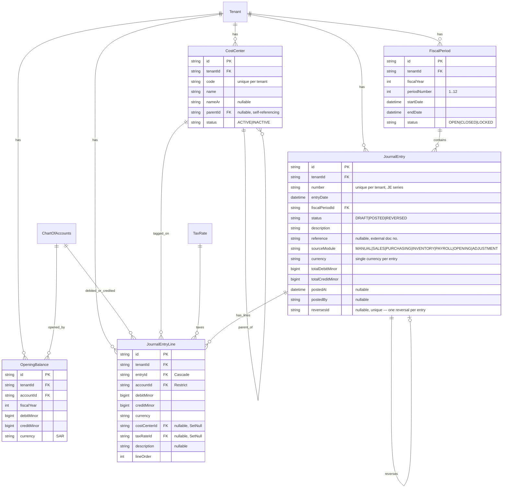

# EsERP Phase 2 — Accounting ERD

Source of truth: `packages/db/prisma/schema.prisma` (migration
`0004_phase2_accounting`; RLS policies in `packages/db/prisma/rls.sql`).
Conventions as Phase 0/1: every table's `id` is `String @id @default(uuid(7))`;
every tenant-scoped table carries `tenantId`, `createdAt`, `updatedAt`,
`createdBy` and a `@@index([tenantId])`. Money is integer minor units
(`BigInt`) + currency code — never floats.

## New tables



## Constraints, indexes, and RLS per table

RLS policy (all five tables): `tenant_isolation`
`USING ("tenantId" = current_setting('app.tenant_id', true) OR
current_setting('app.bootstrap', true) = 'eserp-login')` with the same
`WITH CHECK`, plus `FORCE ROW LEVEL SECURITY` — identical to Phase 0/1.

| Table | Key constraints | Indexes | RLS |
| --- | --- | --- | --- |
| FiscalPeriod | PK `id`; UK `(tenantId, fiscalYear, periodNumber)` | `tenantId`, `fiscalYear` | `tenant_isolation` |
| CostCenter | PK `id`; UK `(code, tenantId)`; FK `parentId → CostCenter` (SetNull, self-ref) | `tenantId`, `parentId` | `tenant_isolation` |
| OpeningBalance | PK `id`; UK `(tenantId, accountId, fiscalYear)`; FK `accountId → ChartOfAccounts` (Cascade) | `tenantId`, `accountId`, `fiscalYear` | `tenant_isolation` |
| JournalEntry | PK `id`; UK `(number, tenantId)`; UK `reversesId`; FK `fiscalPeriodId → FiscalPeriod` (Restrict), `reversesId → JournalEntry` (Restrict) | `tenantId`, `fiscalPeriodId`, `status`, `entryDate` | `tenant_isolation` |
| JournalEntryLine | PK `id`; FK `entryId → JournalEntry` (Cascade), `accountId → ChartOfAccounts` (Restrict), `costCenterId → CostCenter` (SetNull), `taxRateId → TaxRate` (SetNull) | `tenantId`, `entryId`, `accountId`, `costCenterId` | `tenant_isolation` |

## Posting rules

1. **Balance.** Every entry has ≥ 2 lines, at least one debit and one
   credit, `sum(debit) == sum(credit)`, no line with both debit and
   credit > 0, no zero-amount lines, no negative amounts. Enforced by
   `validateJournalLines()` in `@eserp/shared` (`accounting.ts`) and
   re-checked on post.
2. **Posting accounts.** `ChartOfAccounts` has no `isPosting` flag, so an
   account is a posting account iff it is a **leaf** (it has no children).
   Group/header accounts (e.g. `1000` Cash and Cash Equivalents) cannot
   receive lines; the API rejects them with 400. The web UI only offers
   leaf accounts (the read-only `GET /settings/chart-of-accounts`
   endpoint marks each account `isPosting`).
3. **Fiscal period.** The period is derived from `entryDate` (the period
   whose `[startDate, endDate]` contains the date). Postings are only
   allowed into `OPEN` periods: `CLOSED` blocks new postings and
   `LOCKED` is terminal. No two periods may overlap per tenant (checked
   on create with `periodsOverlap()`). Status transitions:
   `OPEN → CLOSED → LOCKED`, `CLOSED → OPEN` (reopen); `LOCKED` has no
   outgoing transitions. A period with journal entries cannot be deleted.
4. **Single currency per entry.** Phase 2 entries carry one currency
   (the tenant default unless the caller passes another). No
   multi-currency entries, no FX conversion on lines.
5. **Immutability.** `DRAFT` entries are editable (lines replaced
   wholesale) and deletable. `POSTED` entries are immutable — corrections
   only via a **reversing entry**: a new `POSTED` entry with swapped
   debit/credit, dated today (so it lands in today's `OPEN` period,
   which may differ from the original's period), `reversesId` pointing
   at the original; the original becomes `REVERSED`. One reversal per
   entry (unique `reversesId`).
6. **Numbering.** Entry numbers come from the `JE` numbering series
   (`JE-{YYYY}-{SEQ:5}`), incremented inside the posting transaction.
   If a tenant has no `JE` series, the posting service creates it.
7. **Reports only count posted movement.** Trial balance, ledger and VAT
   summary include `POSTED` and `REVERSED` entries (a reversed entry's
   amounts stay in history, netted by its reversal entry). `DRAFT`
   entries never count.

## VAT derivation (Saudi Arabia)

For each **posted** journal line in the period that carries a `TaxRate`
link, the tax amount is derived as:

```
taxMinor = round_half_up(lineAmountMinor × rateBps / 10000)
```

where `lineAmountMinor = debitMinor + creditMinor` (exactly one is
non-zero on a valid line) and `rateBps` is the linked rate (1500 = 15%
VAT). Half-up on the exact rational result, in integer minor units —
e.g. 10 halalas × 15% = 1.5 → 2 halalas.

Classification:

- **Output VAT (collected):** tax on a **credit** line to a `REVENUE`
  account, or a credit line to a VAT-output liability account
  (code `211x`).
- **Input VAT (paid):** tax on a **debit** line to an `ASSET` or
  `EXPENSE` account.
- Lines of any other shape are ignored. Net VAT payable =
  output − input (negative = refundable / carried forward).

## Reports

- **Trial balance** (`GET /reports/trial-balance?fiscalPeriodId=…`):
  one row per account with an opening balance or period movement.
  Closing net = (openingDebit − openingCredit) + periodDebit −
  periodCredit, split into closing debit / closing credit columns.
  A balanced ledger has equal closing debit and credit totals.
- **General ledger** (`GET /reports/general-ledger?accountId=…&from=…&to=…`):
  opening net = opening balance for the `from` year + net of posted
  lines before `from`; each line adds debit − credit to a running
  balance, in date then entry-number order.
- **VAT summary** (`GET /reports/vat-summary?fiscalPeriodId=…`): as
  derived above, plus the per-line breakdown.

All report amounts are integer minor units.

## API

| Resource | Endpoints (`/api/v1`) | Permissions |
| --- | --- | --- |
| Journals | `GET /journals` (search, `status`, `fiscalPeriodId`, `sourceModule`, `from`/`to`), `GET /journals/:id`, `POST /journals` (creates a DRAFT), `PATCH /journals/:id` (DRAFT only), `DELETE /journals/:id` (DRAFT only), `POST /journals/:id/post`, `POST /journals/:id/reverse` | `journals:read` / `journals:manage` |
| Fiscal periods | `GET /fiscal-periods` (`fiscalYear`, `status`), `GET /fiscal-periods/:id`, `POST /fiscal-periods`, `PATCH /fiscal-periods/:id` (status only), `DELETE /fiscal-periods/:id` (no entries) | `periods:read` / `periods:manage` |
| Cost centres | `GET /cost-centers` (search, `status`), `GET /cost-centers/:id`, `POST /cost-centers`, `PATCH /cost-centers/:id`, `DELETE /cost-centers/:id` (no children/lines) | `cost-centers:read` / `cost-centers:manage` |
| Opening balances | `GET /opening-balances` (`fiscalYear`), `POST /opening-balances` (upsert per account+year), `PATCH /opening-balances/:id`, `DELETE /opening-balances/:id` | `accounting:read` / `accounting:manage` |
| Reports | `GET /reports/trial-balance`, `GET /reports/general-ledger`, `GET /reports/vat-summary` | `accounting:read` |
| Chart of accounts | `GET /settings/chart-of-accounts` (read-only, each row marked `isPosting`) | `accounting:read` |

`PostingService.postBalanced()` (`apps/api/src/modules/accounting/posting.service.ts`)
is the reusable entry point later phases call to post balanced entries
(Sales / Purchasing / Inventory / Payroll); it applies the same
validation as the manual journal flow. It is not yet wired to any other
module.

### Permissions (added to `ROLE_PERMISSION_MATRIX`)

New permissions: `journals:read`, `journals:manage`, `periods:read`,
`periods:manage`, `cost-centers:read`, `cost-centers:manage`
(`accounting:*` already existed in Phase 0).

| Role | Accounting access |
| --- | --- |
| OWNER / ADMIN | everything |
| ACCOUNTANT | `accounting:*`, `journals:*`, `periods:*`, `cost-centers:*` |
| SALES | `accounting:read`, `journals:read` |
| PURCHASING | `accounting:read`, `journals:read` |
| WAREHOUSE | `accounting:read` |
| HR | none |
| VIEWER | `*:read` (all read permissions) |

## Assumptions made

1. **Leaf = posting account.** The schema has no `isPosting` /
   `accountType` flag on `ChartOfAccounts` (checked before building);
   the leaf rule is the conservative reading of the spec and matches
   the Saudi CoA template (group accounts `1000`, `1100`, `2100`, … have
   children and hold no balances of their own).
2. **One period open per date** is enforced by the overlap check, not a
   database exclusion constraint — periods are monthly in practice and
   the service check covers create; there is no update path that can
   move dates (only status changes).
3. **Reversal date is today**, not the original entry's date, so a
   reversal can always land in an open period even after the original
   period closed. The reversal's description records the original number.
4. **VAT classification is by account type + direction** (see above),
   not by a dedicated VAT account mapping table. A tax rate on a line
   whose shape matches neither side is ignored in the summary.
5. **Opening balances are per account per fiscal year**, independent of
   periods; the trial balance uses the period's fiscal year.
6. **Cost centres have no allocations** in Phase 2 — lines may reference
   one, and that is all.

## Known limitations

- No multi-currency journal entries (single currency per entry).
- No AR/AP subledgers — those come with Sales/Purchasing; journals do
  not link to contacts or invoices.
- No ZATCA e-invoicing (Phase 11).
- No period date editing (only status transitions); no fiscal-year close
  / profit roll-forward into retained earnings.
- No bulk journal import; no recurring / template entries.
- The web journal form works in major units (SAR) and converts to
  minor units ×100 on submit; amounts are rounded to the halala.
