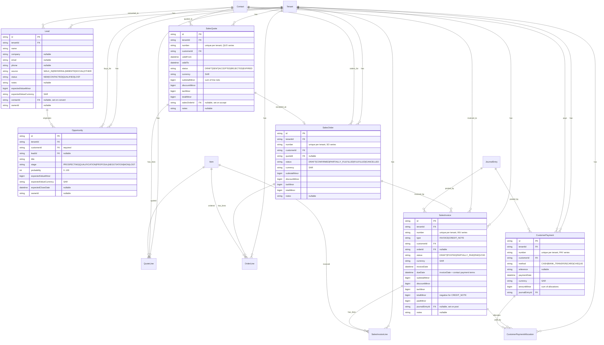

# EsERP Phase 3 — Sales / CRM ERD

Source of truth: `packages/db/prisma/schema.prisma` (migration
`0005_phase3_sales`; RLS policies in `packages/db/prisma/rls.sql`).
Conventions as Phase 0/1/2: every table's `id` is `String @id @default(uuid(7))`;
every tenant-scoped table carries `tenantId`, `createdAt`, `updatedAt`,
`createdBy` and a `@@index([tenantId])`. Money is integer minor units
(`BigInt`) + currency code — never floats. Quantities are `BigInt`.

## New tables



Line tables (`QuoteLine`, `OrderLine`, `SalesInvoiceLine`) share the same
shape: `itemId`, `quantity` (`quantityOrdered` / `quantityFulfilled` on
`OrderLine`), `unitPriceMinor`, `discountPct` (0–100), `taxRateBps`,
`lineSubtotalMinor` (net), `lineDiscountMinor`, `lineTaxMinor`,
`lineTotalMinor`, `lineOrder`. `CustomerPaymentAllocation` is
`paymentId` + `invoiceId` + `amountMinor`.

## Constraints, indexes, and RLS per table

RLS policy (all ten tables): `tenant_isolation`
`USING ("tenantId" = current_setting('app.tenant_id', true) OR
current_setting('app.bootstrap', true) = 'eserp-login')` with the same
`WITH CHECK`, plus `FORCE ROW LEVEL SECURITY` — identical to Phase 0/1/2.

| Table | Key constraints | Indexes | RLS |
| --- | --- | --- | --- |
| Lead | PK `id`; FK `contactId → Contact` (SetNull) | `tenantId`, `status`, `source` | `tenant_isolation` |
| Opportunity | PK `id`; FK `customerId → Contact` (Restrict), `leadId → Lead` (SetNull) | `tenantId`, `customerId`, `stage` | `tenant_isolation` |
| SalesQuote | PK `id`; UK `(number, tenantId)`; FK `customerId → Contact` (Restrict), `salesOrderId → SalesOrder` (SetNull) | `tenantId`, `customerId`, `status` | `tenant_isolation` |
| QuoteLine | PK `id`; FK `quoteId → SalesQuote` (Cascade), `itemId → Item` (Restrict) | `tenantId`, `quoteId`, `itemId` | `tenant_isolation` |
| SalesOrder | PK `id`; UK `(number, tenantId)`; FK `customerId → Contact` (Restrict), `quoteId → SalesQuote` (SetNull) | `tenantId`, `customerId`, `status` | `tenant_isolation` |
| OrderLine | PK `id`; FK `orderId → SalesOrder` (Cascade), `itemId → Item` (Restrict) | `tenantId`, `orderId`, `itemId` | `tenant_isolation` |
| SalesInvoice | PK `id`; UK `(number, tenantId)`; FK `customerId → Contact` (Restrict), `orderId → SalesOrder` (SetNull), `journalEntryId → JournalEntry` (SetNull) | `tenantId`, `customerId`, `status`, `invoiceDate` | `tenant_isolation` |
| SalesInvoiceLine | PK `id`; FK `invoiceId → SalesInvoice` (Cascade), `itemId → Item` (Restrict) | `tenantId`, `invoiceId`, `itemId` | `tenant_isolation` |
| CustomerPayment | PK `id`; UK `(number, tenantId)`; FK `customerId → Contact` (Restrict), `journalEntryId → JournalEntry` (SetNull) | `tenantId`, `customerId`, `paymentDate` | `tenant_isolation` |
| CustomerPaymentAllocation | PK `id`; FK `paymentId → CustomerPayment` (Cascade), `invoiceId → SalesInvoice` (Restrict) | `tenantId`, `paymentId`, `invoiceId` | `tenant_isolation` |

## Document flow

```
Lead ──convert──▶ Contact (CUSTOMER)
  │                  │
  └─▶ Opportunity ───┘
        │
        ▼ (manual: quote created for the customer)
      SalesQuote ──send──▶ SENT ──accept──▶ SalesOrder (DRAFT)
        │   ▲                                │
        │   └─ EXPIRED (computed on read     ▼ confirm (credit-limit check)
        │      when SENT and validTo past)  CONFIRMED
        │                                     │
        │                                     ▼ (invoice created, optionally linked)
        │                                  SalesInvoice ──post──▶ POSTED
        │                                     │  ▲
        │                                     │  └─ VOID only from DRAFT
        │                                     ▼ payments
        │                                  PARTIALLY_PAID ──▶ PAID
        │
        └─ POSTED invoices are corrected by a CREDIT_NOTE, not by voiding.
```

## Line math and VAT

Per line (see `packages/shared/src/sales.ts`):

```
gross    = quantity × unitPriceMinor
discount = round_half_up(gross × discountPct / 100)
net      = gross − discount
tax      = round_half_up(net × taxRateBps / 10000)   (same rule as Phase 2)
total    = net + tax
```

Document totals are the sums of the line columns. `discountPct` is a
whole percent (0–100); `taxRateBps` is basis points (1500 = 15% VAT).

## Posting mappings (Saudi CoA)

All postings go through `PostingService.postBalanced()` with
`sourceModule: 'SALES'` and `reference` = the document number. The entry
date is the invoice/payment date, so it lands in that date's `OPEN`
fiscal period (postings into `CLOSED`/`LOCKED` periods fail with 400,
as in Phase 2).

| Event | Debit | Credit |
| --- | --- | --- |
| Sales invoice posted | 1110 Customers – Local (total) | 4010 Merchandise Sales (net) |
| | | 2110 VAT – Output Tax (tax) |
| Credit note posted (reverse) | 4010 Merchandise Sales (net) | 1110 Customers – Local (total) |
| | 2110 VAT – Output Tax (tax) | |
| Customer payment posted | 1010 Cash on Hand (CASH) or 1020 Banks (BANK_TRANSFER / CARD / CHEQUE) | 1110 Customers – Local (amount) |

The tax rate is linked on the **revenue line only**, so the Phase 2 VAT
summary counts output VAT exactly once. Zero-tax invoices post two lines.

## Business rules

1. **Quote expiry is computed on read.** A `SENT` quote whose `validTo`
   is past is returned as `EXPIRED` (the stored status stays `SENT`); an
   expired quote cannot be accepted (409). There is no scheduler.
2. **Quote accept creates a DRAFT sales order** from the quote lines
   (same items, quantities, prices, tax) and links it
   (`quote.salesOrderId`, `order.quoteId`).
3. **Credit limit on order confirm.** Confirming is blocked with 400
   when `open AR + order total > customer credit limit`, where open AR =
   Σ(total − paid) over the customer's `POSTED` / `PARTIALLY_PAID`
   invoices (credit notes reduce it). A credit limit of `0` means "no
   limit set" and never blocks.
4. **Invoice VOID only from DRAFT.** A `POSTED` invoice is corrected by
   posting a credit note (`type: CREDIT_NOTE`), which stores **negative**
   totals and posts the reverse entries. Payments allocate to `INVOICE`
   rows only.
5. **Payments are allocation-based and post immediately.** A payment has
   no DRAFT state: creation validates every allocation (invoice must be
   `POSTED`/`PARTIALLY_PAID`, same customer, allocation ≤ unpaid
   balance, allocations sum to `amountMinor`), posts the journal entry,
   then updates each invoice's `paidMinor` and status (`PAID` when fully
   paid, else `PARTIALLY_PAID`).
6. **Due date** = `invoiceDate` + the contact's `paymentTermsDays`
   (unless an explicit `dueDate` is supplied).
7. **Fulfilment stays 0 in Phase 3.** `OrderLine.quantityFulfilled` is
   stored but never changed here; Phase 5 Inventory drives it via goods
   issue / delivery.

## AR aging report

`GET /reports/ar-aging?asOf=…` — per customer, unpaid balances of
`POSTED` / `PARTIALLY_PAID` invoices of type `INVOICE`, bucketed by days
past due (`CURRENT` = not yet due, `1–30`, `31–60`, `61–90`, `90+`),
plus per-customer invoice detail and grand totals. Credit notes are not
aged as receivables (they reduce open AR in the credit-limit check).

## API

| Resource | Endpoints (`/api/v1`) | Permissions |
| --- | --- | --- |
| Leads | `GET /leads` (search, `status`, `source`), `GET /leads/:id`, `POST /leads`, `PATCH /leads/:id`, `POST /leads/:id/convert`, `DELETE /leads/:id` | `leads:read` / `leads:manage` |
| Opportunities | `GET /opportunities` (search, `stage`, `customerId`), `GET /opportunities/:id`, `POST /opportunities`, `PATCH /opportunities/:id`, `DELETE /opportunities/:id` | `opportunities:read` / `opportunities:manage` |
| Quotes | `GET /quotes` (search, `status`, `customerId`), `GET /quotes/:id`, `POST /quotes`, `PATCH /quotes/:id` (DRAFT only), `POST /quotes/:id/send`, `POST /quotes/:id/accept`, `POST /quotes/:id/reject`, `DELETE /quotes/:id` (DRAFT only) | `quotes:read` / `quotes:manage` |
| Sales orders | `GET /sales-orders` (search, `status`, `customerId`), `GET /sales-orders/:id`, `POST /sales-orders`, `PATCH /sales-orders/:id` (DRAFT only), `POST /sales-orders/:id/confirm`, `POST /sales-orders/:id/cancel`, `DELETE /sales-orders/:id` (DRAFT only) | `sales-orders:read` / `sales-orders:manage` |
| Sales invoices | `GET /sales-invoices` (search, `status`, `type`, `customerId`, `orderId`), `GET /sales-invoices/:id`, `POST /sales-invoices`, `PATCH /sales-invoices/:id` (DRAFT only), `POST /sales-invoices/:id/post`, `POST /sales-invoices/:id/void`, `DELETE /sales-invoices/:id` (DRAFT only) | `sales-invoices:read` / `sales-invoices:manage` |
| Customer payments | `GET /customer-payments` (search, `customerId`, `method`), `GET /customer-payments/:id`, `POST /customer-payments` | `customer-payments:read` / `customer-payments:manage` |
| Reports | `GET /reports/ar-aging` | `aging:read` |

### Permissions (added to `ROLE_PERMISSION_MATRIX`)

New permissions: `leads:*`, `opportunities:*`, `quotes:*`,
`sales-orders:*`, `sales-invoices:*`, `customer-payments:*`,
`aging:read` (`sales:*` already existed in Phase 0).

| Role | Sales / CRM access |
| --- | --- |
| OWNER / ADMIN | everything |
| ACCOUNTANT | `sales-invoices:*`, `customer-payments:*`, `aging:read`, read on leads/opportunities/quotes/orders |
| SALES | `sales:*`, `leads:*`, `opportunities:*`, `quotes:*`, `sales-orders:*`, `sales-invoices:*`, `customer-payments:*`, `aging:read`; read on purchase orders / supplier invoices |
| PURCHASING | read on sales orders / sales invoices |
| WAREHOUSE | `sales-orders:read` |
| HR | none |
| VIEWER | `*:read` (all read permissions) |

## Web UI

List + create pages under `/[locale]/leads`, `/[locale]/opportunities`,
`/[locale]/quotes`, `/[locale]/sales-orders`, `/[locale]/sales-invoices`,
`/[locale]/customer-payments`, `/[locale]/ar-aging` (en/ar, RTL), with
the shared document-lines editor for quotes, orders and invoices, and
allocation rows for payments.

## Seed

alsafa-trading demo flow: lead Khalid Al-Otaibi (Otaibi Trading, REFERRAL)
→ opportunity "Monthly rice supply — Al-Noor Retail" (WON) → quote
`QUO-2026-00001` (ACCEPTED) → order `SO-2026-00001` (CONFIRMED) →
invoice `INV-2026-00001` (PARTIALLY_PAID: 402,385 total, 200,000 paid,
due 2026-12-20) + payment `PAY-2026-00001` (200,000, bank transfer),
with journal entries `JE-2026-00007` (invoice) and `JE-2026-00008`
(payment). The AR aging report shows Al-Noor Retail with 202,385 in
CURRENT.

## Assumptions made

1. **Single currency per document** (the tenant default unless the
   caller passes another). No multi-currency documents.
2. **A credit limit of 0 means "no limit set"** and never blocks order
   confirmation (the alternative — 0 blocks everything — would make
   every new customer unorderable).
3. **Quote status is stored, expiry is derived.** The stored status
   remains `SENT` after `validTo` passes; only the API presentation
   (and the accept guard) treat it as `EXPIRED`.
4. **Payments post immediately** — there is no draft/approval state for
   payments in this phase; a payment that fails validation posts nothing.
5. **Invoice lines are priced manually** (unit price from the caller or
   the item's sales price in the web UI). Price-list date selection is
   not enforced at read time (Phase 1 limitation, unchanged).

## Known limitations

- No goods issue / delivery notes — fulfilment is Phase 5.
- No delivery or shipment tracking on orders.
- No ZATCA e-invoicing (Phase 11).
- No dunning / reminder letters for overdue invoices.
- No per-line cost-centre tagging on sales documents.
- The web payment form supports multiple allocation rows, but each
  allocation must target a `POSTED` or `PARTIALLY_PAID` invoice.
