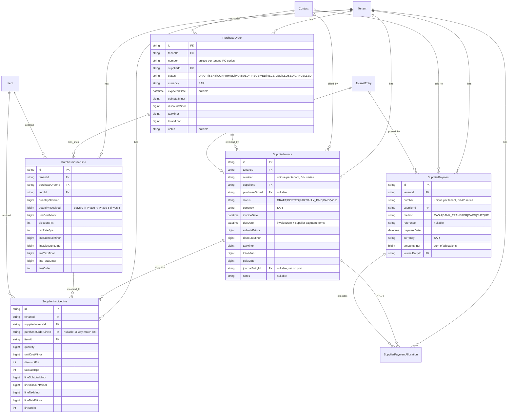

# EsERP Phase 4 — Purchasing ERD

Source of truth: `packages/db/prisma/schema.prisma` (migration
`0006_phase4_purchasing`; RLS policies in `packages/db/prisma/rls.sql`).
Conventions as Phase 0/1/2/3: every table's `id` is `String @id @default(uuid(7))`;
every tenant-scoped table carries `tenantId`, `createdAt`, `updatedAt`,
`createdBy` and a `@@index([tenantId])`. Money is integer minor units
(`BigInt`) + currency code — never floats. Quantities are `BigInt`.

## New tables



`SupplierPaymentAllocation` is `paymentId` + `invoiceId` + `amountMinor`.
Line math is identical to Phase 3 (`packages/shared/src/sales.ts`):
gross = qty × price; discount = round_half_up(gross × pct / 100);
net = gross − discount; tax = round_half_up(net × rateBps / 10000);
total = net + tax.

## Constraints, indexes, and RLS per table

RLS policy (all six tables): `tenant_isolation`
`USING ("tenantId" = current_setting('app.tenant_id', true) OR
current_setting('app.bootstrap', true) = 'eserp-login')` with the same
`WITH CHECK`, plus `FORCE ROW LEVEL SECURITY` — identical to Phase 0/1/2/3.

| Table | Key constraints | Indexes | RLS |
| --- | --- | --- | --- |
| PurchaseOrder | PK `id`; UK `(number, tenantId)`; FK `supplierId → Contact` (Restrict) | `tenantId`, `supplierId`, `status` | `tenant_isolation` |
| PurchaseOrderLine | PK `id`; FK `purchaseOrderId → PurchaseOrder` (Cascade), `itemId → Item` (Restrict) | `tenantId`, `purchaseOrderId`, `itemId` | `tenant_isolation` |
| SupplierInvoice | PK `id`; UK `(number, tenantId)`; FK `supplierId → Contact` (Restrict), `purchaseOrderId → PurchaseOrder` (SetNull), `journalEntryId → JournalEntry` (SetNull) | `tenantId`, `supplierId`, `status`, `invoiceDate` | `tenant_isolation` |
| SupplierInvoiceLine | PK `id`; FK `supplierInvoiceId → SupplierInvoice` (Cascade), `purchaseOrderLineId → PurchaseOrderLine` (SetNull), `itemId → Item` (Restrict) | `tenantId`, `supplierInvoiceId`, `itemId` | `tenant_isolation` |
| SupplierPayment | PK `id`; UK `(number, tenantId)`; FK `supplierId → Contact` (Restrict), `journalEntryId → JournalEntry` (SetNull) | `tenantId`, `supplierId`, `paymentDate` | `tenant_isolation` |
| SupplierPaymentAllocation | PK `id`; FK `paymentId → SupplierPayment` (Cascade), `invoiceId → SupplierInvoice` (Restrict) | `tenantId`, `paymentId`, `invoiceId` | `tenant_isolation` |

## Document flow

```
PurchaseOrder ──send──▶ SENT ──confirm──▶ CONFIRMED (sent to supplier)
  │  ▲
  │  └─ No ledger posting for the PO itself (commitment only).
  │
  └─▶ SupplierInvoice (optionally linked) ──post──▶ POSTED
        │  ▲                                    │
        │  └─ VOID only from DRAFT              ▼ payments
        │                                    PARTIALLY_PAID ──▶ PAID
        │
        └─ 3-way match runs on post when linked to a PO (see below).
```

Goods receipt itself is Phase 5: `PurchaseOrderLine.quantityReceived`
stays 0 in Phase 4, and the `PARTIALLY_RECEIVED` / `RECEIVED` statuses
are reserved for Phase 5 to set.

## Posting mappings (Saudi CoA)

All postings go through `PostingService.postBalanced()` with
`sourceModule: 'PURCHASING'` and `reference` = the document number.
The entry date is the invoice/payment date, so it lands in that date's
`OPEN` fiscal period.

| Event | Debit | Credit |
| --- | --- | --- |
| Supplier invoice posted | 5100 Merchandise Purchases (net) | 2010 Suppliers – Local (total) |
| | 2120 VAT – Input Tax (tax) | |
| Supplier payment posted | 2010 Suppliers – Local (amount) | 1010 Cash on Hand (CASH) or 1020 Banks (BANK_TRANSFER / CARD / CHEQUE) |

The tax rate is linked on the **purchases line only**, so the Phase 2
VAT summary counts input VAT exactly once. Zero-tax invoices post two
lines. **A purchase order posts nothing** — it is a commitment only.

## 3-way match (on supplier-invoice posting)

Runs only when the invoice is linked to a purchase order
(`purchaseOrderId` set). Each invoice line carrying a
`purchaseOrderLineId` is checked against its PO line
(`packages/shared/src/sales.ts` `threeWayMatchError`):

1. **Quantity:** already-invoiced quantity on the PO line (from other
   non-`VOID` invoices) + this line's quantity must not exceed the PO
   ordered quantity. Over-invoicing blocks posting with 400.
2. **Price:** unit-price variance over **5%** blocks posting with 400
   (exactly 5% passes; integer math, no floats). A PO price of 0 with a
   non-zero invoice price also blocks.

Lines without a `purchaseOrderLineId` are not matched (e.g. ad-hoc
charges on a PO-linked invoice). An unlinked invoice (no
`purchaseOrderId`) skips the match entirely. The same checks run on
create for line/link validity, but the quantity/price enforcement point
is **posting** — a DRAFT invoice can be saved and corrected first.

## Business rules

1. **Approval is DRAFT → SENT → CONFIRMED** (confirmed = sent to the
   supplier). `CLOSE` is allowed from `CONFIRMED` / `PARTIALLY_RECEIVED`
   / `RECEIVED`; `CANCEL` from `DRAFT` / `SENT` / `CONFIRMED`.
2. **Supplier payments are allocation-based and post immediately**,
   mirroring customer payments: allocations validated (invoice must be
   `POSTED`/`PARTIALLY_PAID`, same supplier, allocation ≤ unpaid
   balance, allocations sum to `amountMinor`), journal entry posted,
   then each invoice's `paidMinor` and status updated.
3. **Due date** = `invoiceDate` + the supplier's `paymentTermsDays`
   (unless an explicit `dueDate` is supplied).
4. **VOID only from DRAFT** for supplier invoices, as for sales
   invoices.

## AP aging report

`GET /reports/ap-aging?asOf=…` — per supplier, unpaid balances of
`POSTED` / `PARTIALLY_PAID` supplier invoices, bucketed with the same
buckets as AR aging (`CURRENT` | `1–30` | `31–60` | `61–90` | `90+`),
plus per-supplier invoice detail and grand totals.

## API

| Resource | Endpoints (`/api/v1`) | Permissions |
| --- | --- | --- |
| Purchase orders | `GET /purchase-orders` (search, `status`, `supplierId`), `GET /purchase-orders/:id`, `POST /purchase-orders`, `PATCH /purchase-orders/:id` (DRAFT only), `POST /purchase-orders/:id/send`, `POST /purchase-orders/:id/confirm`, `POST /purchase-orders/:id/close`, `POST /purchase-orders/:id/cancel`, `DELETE /purchase-orders/:id` (DRAFT only) | `purchase-orders:read` / `purchase-orders:manage` |
| Supplier invoices | `GET /supplier-invoices` (search, `status`, `supplierId`, `purchaseOrderId`), `GET /supplier-invoices/:id`, `POST /supplier-invoices`, `PATCH /supplier-invoices/:id` (DRAFT only), `POST /supplier-invoices/:id/post`, `POST /supplier-invoices/:id/void`, `DELETE /supplier-invoices/:id` (DRAFT only) | `supplier-invoices:read` / `supplier-invoices:manage` |
| Supplier payments | `GET /supplier-payments` (search, `supplierId`, `method`), `GET /supplier-payments/:id`, `POST /supplier-payments` | `supplier-payments:read` / `supplier-payments:manage` |
| Reports | `GET /reports/ap-aging` | `aging:read` |

### Permissions (added to `ROLE_PERMISSION_MATRIX`)

New permissions: `purchase-orders:*`, `supplier-invoices:*`,
`supplier-payments:*` (`purchasing:*` and `aging:read` already existed /
were added in Phase 3).

| Role | Purchasing access |
| --- | --- |
| OWNER / ADMIN | everything |
| ACCOUNTANT | `supplier-invoices:*`, `supplier-payments:*`, `aging:read`, read on purchase orders |
| SALES | read on purchase orders / supplier invoices |
| PURCHASING | `purchasing:*`, `purchase-orders:*`, `supplier-invoices:*`, `supplier-payments:*`, `aging:read`; read on sales orders / sales invoices |
| WAREHOUSE | `purchase-orders:read` |
| HR | none |
| VIEWER | `*:read` (all read permissions) |

## Web UI

List + create pages under `/[locale]/purchase-orders`,
`/[locale]/supplier-invoices`, `/[locale]/supplier-payments`,
`/[locale]/ap-aging` (en/ar, RTL). The supplier-invoice form links
each line to the matching PO line (same item) so the 3-way match can
run on posting.

## Seed

alsafa-trading demo flow: purchase order `PO-2026-00001` (CONFIRMED,
Saudi Grains, 50 × Basmati Rice @ 28.00 = 161,000) → supplier invoice
`SIN-2026-00001` (PARTIALLY_PAID: 161,000 total, 100,000 paid, due
2026-12-21, line linked to the PO line) + payment `SPAY-2026-00001`
(100,000, bank transfer), with journal entries `JE-2026-00009`
(invoice) and `JE-2026-00010` (payment). The AP aging report shows
Saudi Grains with 61,000 in CURRENT.

## Assumptions made

1. **Single currency per document** (the tenant default unless the
   caller passes another). No multi-currency documents.
2. **The 3-way match is enforced at posting, not at creation** — a
   DRAFT invoice that fails the match can be saved and corrected.
3. **Goods receipt is out of scope** (Phase 5): quantities received
   stay 0 and receipt statuses are not set by any Phase 4 endpoint.
4. **No credit-note equivalent for supplier invoices** in this phase;
   a wrongly posted supplier invoice is corrected by a reversing
   journal entry (Phase 2) until a supplier credit note lands in a
   later phase.

## Known limitations

- No goods receipt / stock movements (Phase 5).
- No supplier credit notes.
- No PO approval limits / multi-level approval workflow.
- No landed-cost / freight allocation on supplier invoices.
- No ZATCA e-invoicing (Phase 11).
