# EsERP Phase 5 — Inventory ERD

Source of truth: `packages/db/prisma/schema.prisma` (migration
`0007_phase5_inventory`; RLS policies in `packages/db/prisma/rls.sql`).
Conventions as Phase 0/1/2/3/4: every table's `id` is
`String @id @default(uuid(7))`; every tenant-scoped table carries
`tenantId`, `createdAt`, `updatedAt`, `createdBy` and a
`@@index([tenantId])`. Money is integer minor units (`BigInt`) +
currency code — never floats. Quantities are `BigInt`.

## New tables

```mermaid
erDiagram
  Tenant ||--o{ StockLevel : has
  Tenant ||--o{ StockCostLayer : has
  Tenant ||--o{ StockMovement : has
  Tenant ||--o{ GoodsReceipt : has
  Tenant ||--o{ GoodsReceiptLine : has
  Tenant ||--o{ DeliveryNote : has
  Tenant ||--o{ DeliveryNoteLine : has
  Tenant ||--o{ StockAdjustment : has
  Tenant ||--o{ StockAdjustmentLine : has
  Tenant ||--o{ StockTransfer : has
  Tenant ||--o{ StockTransferLine : has
  Tenant ||--o{ StockCount : has
  Tenant ||--o{ StockCountLine : has

  Warehouse ||--o{ StockLevel : holds
  Item ||--o{ StockLevel : stocked_as
  Item ||--o{ StockCostLayer : layered_as
  Item ||--o{ StockMovement : moved
  PurchaseOrder ||--o{ GoodsReceipt : received_by
  GoodsReceipt ||--o{ GoodsReceiptLine : has_lines
  PurchaseOrderLine ||--o{ GoodsReceiptLine : received_as
  SalesOrder ||--o{ DeliveryNote : delivered_by
  DeliveryNote ||--o{ DeliveryNoteLine : has_lines
  OrderLine ||--o{ DeliveryNoteLine : delivered_as
  JournalEntry ||--o{ GoodsReceipt : posted_by
  JournalEntry ||--o{ DeliveryNote : posted_by
  JournalEntry ||--o{ StockAdjustment : posted_by
  JournalEntry ||--o{ StockCount : posted_by

  StockLevel {
    string id PK
    string tenantId FK
    string warehouseId FK
    string itemId FK
    bigint qtyOnHand
    bigint qtyReserved
    bigint averageCostMinor
    bigint lastCostMinor
    string currency
  }
  StockCostLayer {
    string id PK
    string tenantId FK
    string warehouseId FK
    string itemId FK
    string sourceType
    string sourceId
    bigint quantityRemaining
    bigint unitCostMinor
    datetime receivedAt
  }
  StockMovement {
    string id PK
    string tenantId FK
    string type "IN|OUT|TRANSFER|ADJUSTMENT|RETURN_IN|RETURN_OUT"
    string itemId FK
    string warehouseId FK
    string destinationWarehouseId FK "nullable"
    bigint quantity "always positive; direction implied by type"
    bigint unitCostMinor
    bigint totalCostMinor
    string sourceType "GOODS_RECEIPT|DELIVERY_NOTE|POS_SALE|ADJUSTMENT|COUNT|TRANSFER"
    string sourceId
    string reference
    datetime movementDate
  }
  GoodsReceipt {
    string id PK
    string tenantId FK
    string number "unique per tenant, GRN series"
    string purchaseOrderId FK "required"
    string warehouseId FK
    string status "DRAFT|POSTED|CANCELLED"
    datetime receiptDate
    bigint subtotalMinor
    bigint totalCostMinor
    string journalEntryId FK "nullable, set on post"
  }
  DeliveryNote {
    string id PK
    string tenantId FK
    string number "unique per tenant, DN series"
    string salesOrderId FK "required"
    string warehouseId FK
    string status "DRAFT|POSTED|CANCELLED"
    datetime deliveryDate
    bigint totalCostMinor "COGS at valuation cost"
    string journalEntryId FK "nullable, set on post"
  }
  StockAdjustment {
    string id PK
    string tenantId FK
    string number "unique per tenant, ADJ series"
    string warehouseId FK
    string status "DRAFT|POSTED|CANCELLED"
    datetime adjustmentDate
    bigint totalValueMinor "signed net value"
    string journalEntryId FK "nullable, set on post"
  }
  StockTransfer {
    string id PK
    string tenantId FK
    string number "unique per tenant, TRF series"
    string fromWarehouseId FK
    string toWarehouseId FK
    string status "DRAFT|POSTED|CANCELLED"
    datetime transferDate
    bigint totalCostMinor
  }
  StockCount {
    string id PK
    string tenantId FK
    string number "unique per tenant, CNT series"
    string warehouseId FK
    string status "DRAFT|APPROVED|CANCELLED"
    datetime countDate
    string journalEntryId FK "nullable, set on approve"
  }
```



Line tables (`GoodsReceiptLine`, `DeliveryNoteLine`,
`StockAdjustmentLine`, `StockTransferLine`, `StockCountLine`) carry
`itemId`, quantities, `unitCostMinor` and `lineTotalMinor`; the count
line also snapshots `systemQuantity`, `countedQuantity` and
`varianceQuantity` (counted − system); the adjustment line carries a
signed `quantityDelta` and a `reason`
(`DAMAGE | THEFT | FOUND | CORRECTION | OTHER`).

## Constraints, indexes, and RLS per table

RLS policy (all thirteen tables): `tenant_isolation`
`USING ("tenantId" = current_setting('app.tenant_id', true) OR
current_setting('app.bootstrap', true) = 'eserp-login')` with the same
`WITH CHECK`, plus `FORCE ROW LEVEL SECURITY` — identical to Phase 0–4.

| Table | Key constraints | Indexes | RLS |
| --- | --- | --- | --- |
| StockLevel | PK `id`; UK `(warehouseId, itemId, tenantId)` | `tenantId`, `warehouseId`, `itemId` | `tenant_isolation` |
| StockCostLayer | PK `id`; FK `warehouseId`/`itemId` (Restrict) | `tenantId`, `(warehouseId, itemId, receivedAt)`, `itemId` | `tenant_isolation` |
| StockMovement | PK `id`; FK `itemId`/`warehouseId` (Restrict), `destinationWarehouseId` (Restrict), `journalEntryId` (SetNull) | `tenantId`, `itemId`, `warehouseId`, `(sourceType, sourceId)`, `movementDate` | `tenant_isolation` |
| GoodsReceipt | PK `id`; UK `(number, tenantId)`; FK `purchaseOrderId`/`warehouseId` (Restrict), `journalEntryId` (SetNull) | `tenantId`, `purchaseOrderId`, `warehouseId`, `status` | `tenant_isolation` |
| GoodsReceiptLine | PK `id`; FK `goodsReceiptId` (Cascade), `purchaseOrderLineId`/`itemId` (Restrict) | `tenantId`, `goodsReceiptId`, `purchaseOrderLineId`, `itemId` | `tenant_isolation` |
| DeliveryNote | PK `id`; UK `(number, tenantId)`; FK `salesOrderId`/`warehouseId` (Restrict), `journalEntryId` (SetNull) | `tenantId`, `salesOrderId`, `warehouseId`, `status` | `tenant_isolation` |
| DeliveryNoteLine | PK `id`; FK `deliveryNoteId` (Cascade), `salesOrderLineId`/`itemId` (Restrict) | `tenantId`, `deliveryNoteId`, `salesOrderLineId`, `itemId` | `tenant_isolation` |
| StockAdjustment | PK `id`; UK `(number, tenantId)`; FK `warehouseId` (Restrict), `journalEntryId` (SetNull) | `tenantId`, `warehouseId`, `status` | `tenant_isolation` |
| StockAdjustmentLine | PK `id`; FK `stockAdjustmentId` (Cascade), `itemId` (Restrict) | `tenantId`, `stockAdjustmentId`, `itemId` | `tenant_isolation` |
| StockTransfer | PK `id`; UK `(number, tenantId)`; FK `fromWarehouseId`/`toWarehouseId` (Restrict) | `tenantId`, `fromWarehouseId`, `toWarehouseId`, `status` | `tenant_isolation` |
| StockTransferLine | PK `id`; FK `stockTransferId` (Cascade), `itemId` (Restrict) | `tenantId`, `stockTransferId`, `itemId` | `tenant_isolation` |
| StockCount | PK `id`; UK `(number, tenantId)`; FK `warehouseId` (Restrict), `journalEntryId` (SetNull) | `tenantId`, `warehouseId`, `status` | `tenant_isolation` |
| StockCountLine | PK `id`; FK `stockCountId` (Cascade), `itemId` (Restrict) | `tenantId`, `stockCountId`, `itemId` | `tenant_isolation` |

## Document flows

```
PurchaseOrder (CONFIRMED) ──▶ GoodsReceipt (DRAFT) ──post──▶ POSTED
  │                              │  ▲ stock in, PO line qtyReceived += qty
  │                              │  └─ PO status PARTIALLY_RECEIVED → RECEIVED
  │                              └─ Dr 1210 / Cr 2020 GRNI (net receipt cost)

SalesOrder (CONFIRMED) ──▶ DeliveryNote (DRAFT) ──post──▶ POSTED
  │                           │  ▲ stock out at valuation cost, reservation released
  │                           │  └─ order line qtyFulfilled += qty
  │                           └─ Dr 5010 COGS / Cr 1210; order PARTIALLY_FULFILLED → FULFILLED

StockAdjustment (DRAFT) ──post──▶ POSTED (net value: Dr 1210 / Cr 4110 gain,
  or Dr 5240 / Cr 1210 loss)
StockTransfer (DRAFT) ──post──▶ POSTED (OUT + IN movements, same cost, no JE)
StockCount (DRAFT) ──approve──▶ APPROVED (variance movements + net JE like an adjustment)
```

All five document types: create as DRAFT, post/approve applies the
stock + ledger effects, cancel/delete only from DRAFT. Movements are
append-only — a wrong posting is corrected by a new reversing document,
never by editing a movement row.

## Valuation — exact algorithm

Implemented in `apps/api/src/modules/inventory/stock.service.ts`
(`receipt()` / `issue()`), with the pure math in
`packages/shared/src/inventory.ts` (`consumeFifo`,
`weightedAverageCost`, `unitIssueCost`).

- **FIFO** (`Item.costingMethod = 'FIFO'`): each receipt creates one
  `StockCostLayer` (`quantityRemaining`, `unitCostMinor`, `receivedAt`).
  An issue consumes layers oldest-first (`receivedAt`, then `createdAt`)
  via `consumeFifo()`; the issue cost is the sum of
  `taken × layer unit cost`. If the layers cover only part of the stock
  (e.g. opening stock with no layers), the remainder is valued at the
  level's `averageCostMinor` (falling back to `lastCostMinor`).
- **WEIGHTED_AVERAGE**: receipts recompute
  `averageCostMinor = (prevQty × prevAvg + newQty × newCost) / (prevQty + newQty)`
  with integer division truncating toward zero (the remainder is under
  one minor unit per unit and is absorbed on the next receipt). Issues
  use `averageCostMinor` (falling back to `lastCostMinor` when 0).
- **STANDARD**: issues always use `Item.standardCostMinor`; receipts do
  not change the issue cost (the level's `averageCostMinor` is still
  maintained for reporting/fallback).
- `StockLevel.averageCostMinor` and `lastCostMinor` are updated on every
  receipt for all methods. `qtyAvailable` is computed, never stored:
  `qtyOnHand − qtyReserved`.
- Items with `trackStock = false` skip stock entirely (no levels, layers
  or movements; issue/receipt cost 0).

## Reservations

Sales orders have no warehouse of their own in Phase 5, so confirming
an order reserves its unfulfilled quantities against the tenant's
**default warehouse** (`StockService.reserveForOrder`, called from
`OrdersService.confirm`). Delivery releases the delivered quantity at
the delivery warehouse; cancellation releases the remaining unfulfilled
quantity. A tenant with no warehouse yet gets no reservation — confirm
must keep working for sales-only tenants. Reservation is aggregate on
`StockLevel.qtyReserved` (no per-order rows); available stock may go
negative when an order is reserved beyond on-hand (backorder).

## Posting mappings (Saudi CoA)

All postings go through `PostingService.postBalanced()` with
`sourceModule: 'INVENTORY'` and `reference` = the document number.
New CoA accounts added in Phase 5 (`saudi-coa.json`):
**2020 Goods Received Not Invoiced** (LIABILITY, parent 2000),
**5010 Cost of Goods Sold** (EXPENSE, parent 5000),
**5240 Inventory Adjustments and Shrinkage** (EXPENSE, parent 5200),
**4110 Inventory Adjustment Gains** (REVENUE, parent 4100).

| Event | Debit | Credit |
| --- | --- | --- |
| Goods receipt posted (net cost) | 1210 Merchandise Inventory | 2020 GRNI |
| Delivery note posted (valuation cost) | 5010 Cost of Goods Sold | 1210 Merchandise Inventory |
| Adjustment posted, net increase | 1210 Merchandise Inventory | 4110 Inventory Adjustment Gains |
| Adjustment posted, net decrease | 5240 Inventory Adjustments | 1210 Merchandise Inventory |
| Count approved, net surplus / shortage | as adjustment above | as adjustment above |
| Stock transfer posted | — (no journal entry) | — |

A zero-value posting is skipped (no journal entry is created).

## GRNI relief on supplier invoices (Phase 4 extension)

`SupplierInvoicesService.post` now computes, per invoice line linked to
a PO line, the received portion:
`matchedQty = min(line qty, posted-GRN qty − already-invoiced qty)`,
valued at the line's net unit value (`lineSubtotalMinor / quantity`).
That portion posts **Dr 2020 GRNI** instead of **Dr 5100 Purchases**;
the unreceived portion still posts Dr 5100, VAT still posts
Dr 2120 / Cr 2010 for the full invoice. The tax rate is linked on the
purchases line when it exists, otherwise on the GRNI line; the Phase 2
VAT summary was extended (`computeVatSummary`) to treat a debit to
2020 with a tax rate as an input-VAT base. The seeded Phase 4 demo
invoice (`SIN-2026-00001`) has no receipt, so its posting is unchanged
(Dr 5100 / Dr 2120 / Cr 2010).

## Low-stock report

`GET /inventory/reports/low-stock?warehouseId=…` — stock levels whose
`qtyOnHand <= Item.reorderPoint`, with on-hand, reserved, available and
reorder point per warehouse, plus a web page.

## API

| Resource | Endpoints (`/api/v1`) | Permissions |
| --- | --- | --- |
| Stock levels | `GET /inventory/stock` (warehouseId, itemId, search, lowStockOnly) | `stock:read` |
| Movements | `GET /inventory/movements` (type, sourceType, sourceId, warehouseId, itemId) | `stock:read` |
| Goods receipts | `GET /inventory/goods-receipts`, `GET /inventory/goods-receipts/:id`, `POST`, `POST /:id/post`, `POST /:id/cancel`, `DELETE /:id` (DRAFT only) | `goods-receipts:read` / `goods-receipts:manage` |
| Delivery notes | same shape under `/inventory/delivery-notes` | `delivery-notes:read` / `delivery-notes:manage` |
| Adjustments | same shape under `/inventory/adjustments` | `adjustments:read` / `adjustments:manage` |
| Transfers | same shape under `/inventory/transfers` | `transfers:read` / `transfers:manage` |
| Counts | `GET /inventory/counts`, `GET /:id`, `POST`, `POST /:id/approve`, `POST /:id/cancel`, `DELETE /:id` (DRAFT only) | `counts:read` / `counts:manage` |
| Reports | `GET /inventory/reports/low-stock` | `stock:read` |

### Permissions (added to `ROLE_PERMISSION_MATRIX`)

New permissions: `stock:*`, `goods-receipts:*`, `delivery-notes:*`,
`adjustments:*`, `transfers:*`, `counts:*` (`inventory:*` already existed).

| Role | Inventory access |
| --- | --- |
| OWNER / ADMIN | everything |
| ACCOUNTANT | `stock:read`, `inventory:read` (+ POS reports, see Phase 6) |
| SALES | `stock:read`, `delivery-notes:read` |
| PURCHASING | `stock:read`, `goods-receipts:read` |
| WAREHOUSE | `inventory:*`, `stock:*`, `goods-receipts:*`, `delivery-notes:*`, `adjustments:*`, `transfers:*`, `counts:*` |
| HR | none |
| VIEWER | `*:read` (all read permissions) |

## Web UI

List + create/post pages under `/[locale]/stock-levels`,
`/[locale]/stock-movements`, `/[locale]/goods-receipts`,
`/[locale]/delivery-notes`, `/[locale]/stock-adjustments`,
`/[locale]/stock-transfers`, `/[locale]/stock-counts`,
`/[locale]/low-stock` (en/ar, RTL).

## Seed

alsafa-trading demo flow (2026-11-24, period 11 OPEN):
`GRN-2026-00001` receives 30 of the 50 demo-PO rice @ 28.00 into
`WH-RIY-01` (PO → PARTIALLY_RECEIVED, JE-2026-00011 Dr 1210 / Cr 2020,
84,000) → `DN-2026-00001` delivers 20 of the 100 demo-SO rice (SO →
PARTIALLY_FULFILLED, reservation 100 → 80, JE-2026-00012 Dr 5010 /
Cr 1210, 56,000) → `ADJ-2026-00001` damages 2 rice (JE-2026-00013
Dr 5240 / Cr 1210, 5,600). Final rice level in `WH-RIY-01`: on hand 5
(30 − 20 − 2 − 3 POS sales), reserved 80, average cost 2,800, one FIFO
layer with 5 remaining; the low-stock report shows rice (5 ≤ reorder
point 50). The demo supplier invoice keeps its Phase 4 posting.

## Assumptions made

1. **Reservations use the default warehouse** — sales orders carry no
   warehouse in Phase 5.
2. **GRN cost is the PO line's net unit cost** (ex-VAT); VAT is only
   recognised on the supplier invoice.
3. **A receipt cannot exceed the PO ordered quantity** (net of prior
   receipts); a delivery cannot exceed the order quantity (net of prior
   fulfilments); an issue cannot exceed on-hand stock (400).
4. **Positive adjustments/count surpluses are valued at the given unit
   cost, or the item's purchase price when none is given**; negative
   ones use valuation cost (or a given unit cost override).
5. **Transfers post no journal entry** — inventory value only changes
   location.
6. **No per-order reservation rows** — reservation is an aggregate
   counter on `StockLevel`.
7. **FIFO layer shortfall falls back to the average cost** (see
   Valuation above) so stock that predates layers can still be issued.

## Known limitations

- No landed-cost / freight allocation on receipts.
- No serial/batch (lot) tracking — layers are per receipt, not per serial.
- No multi-warehouse allocation on sales orders (default warehouse only).
- No supplier credit notes (a wrongly posted supplier invoice is still
  corrected by a reversing journal entry).
- No ZATCA e-invoicing (Phase 11).
