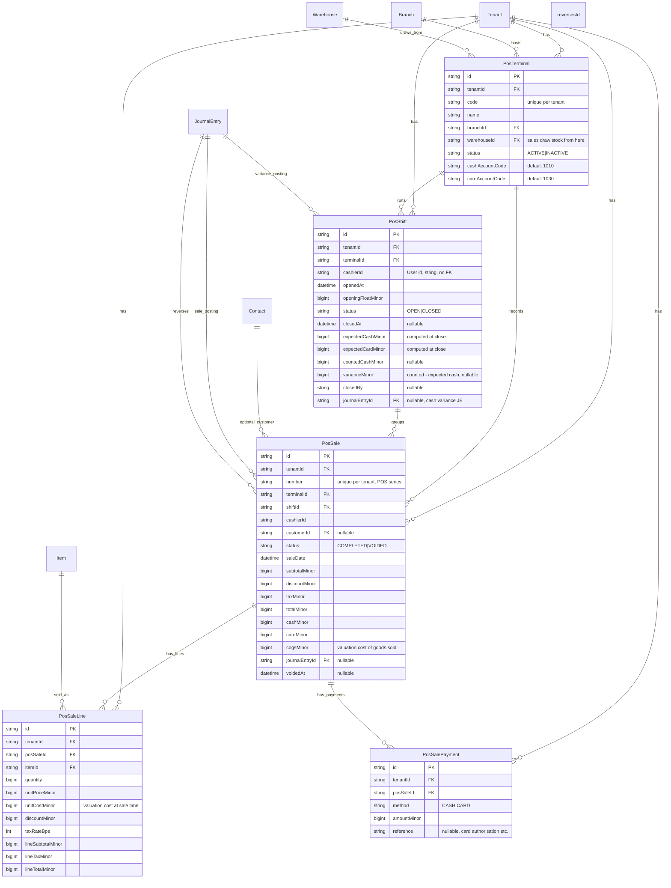

# EsERP Phase 6 — POS ERD

Source of truth: `packages/db/prisma/schema.prisma` (migration
`0008_phase6_pos`; RLS policies in `packages/db/prisma/rls.sql`).
Conventions as Phase 0/1/2/3/4/5: every table's `id` is
`String @id @default(uuid(7))`; every tenant-scoped table carries
`tenantId`, `createdAt`, `updatedAt`, `createdBy` and a
`@@index([tenantId])`. Money is integer minor units (`BigInt`) +
currency code — never floats. Quantities are `BigInt`.

## New tables



## Constraints, indexes, and RLS per table

RLS policy (all five tables): `tenant_isolation`
`USING ("tenantId" = current_setting('app.tenant_id', true) OR
current_setting('app.bootstrap', true) = 'eserp-login')` with the same
`WITH CHECK`, plus `FORCE ROW LEVEL SECURITY` — identical to Phase 0–5.

| Table | Key constraints | Indexes | RLS |
| --- | --- | --- | --- |
| PosTerminal | PK `id`; UK `(code, tenantId)`; FK `branchId`/`warehouseId` (Restrict) | `tenantId`, `branchId`, `warehouseId`, `status` | `tenant_isolation` |
| PosShift | PK `id`; FK `terminalId` (Restrict), `journalEntryId` (SetNull) | `tenantId`, `terminalId`, `status`, `openedAt` | `tenant_isolation` |
| PosSale | PK `id`; UK `(number, tenantId)`; FK `terminalId`/`shiftId` (Restrict), `customerId` (SetNull), `journalEntryId` (SetNull) | `tenantId`, `terminalId`, `shiftId`, `status`, `saleDate` | `tenant_isolation` |
| PosSaleLine | PK `id`; FK `posSaleId` (Cascade), `itemId` (Restrict) | `tenantId`, `posSaleId`, `itemId` | `tenant_isolation` |
| PosSalePayment | PK `id`; FK `posSaleId` (Cascade) | `tenantId`, `posSaleId` | `tenant_isolation` |

## Flows

```
Terminal (ACTIVE, branch + warehouse)
  └─▶ Shift OPEN (one OPEN shift per terminal; opening float ≥ 0)
        └─▶ PosSale (COMPLETED)
        │     • stock OUT at valuation cost from the terminal warehouse
        │       (StockMovement source POS_SALE, linked to the sale)
        │     • one combined journal entry per sale (see Posting below)
        │     • void (same OPEN shift only) → stock RETURN_IN at the
        │       original unit costs + reversing journal entry
        └─▶ Shift CLOSED (locked; no more sales)
              • Z-report: sales count, gross, discounts, VAT, net,
                cash/card split, expected vs counted cash, variance
              • cash variance ≠ 0 → journal entry to 5250
```

## POS sale rules

- The shift must be OPEN and belong to the terminal; the terminal must
  be ACTIVE.
- Lines: item, quantity ≥ 1, unit price (default = default price list
  best quantity break, else the item's `salesPriceMinor`), tax rate
  (default = the item's tax rate, else 1500 bps = 15%).
- Totals are computed server-side from lines with
  `computeDocTotals()` (same as sales/purchasing); the payment split
  (CASH and/or CARD, one row per method) must equal the sale total
  exactly, and the total must be positive — otherwise 400.
- The lookup endpoint `GET /pos/lookup?terminalId=…&code=…` matches by
  exact SKU **or** barcode and returns the item, the default price and
  the available stock at the terminal's warehouse in one query.
- A sale issues stock **before** the journal entry is posted, so a
  stock shortfall aborts the whole sale (transactional).
- A voided sale cannot be un-voided; it is excluded from Z-report
  totals.
- Pricing is decided at sale time — a later price-list change never
  rewrites a completed sale.

## Posting mappings (Saudi CoA)

All postings go through `PostingService.postBalanced()` with
`sourceModule: 'POS'` and `reference` = the sale number (or
`SHIFT:<code>` for the variance entry). New CoA accounts added in
Phase 5/6 (`saudi-coa.json`): **1030 Card Payments Clearing**
(ASSET, parent 1000), **5250 Cash Over / Short** (EXPENSE, parent
5200). Existing: **1010 Cash**, **4010 Sales Revenue**,
**2110 Output VAT**, **5010 Cost of Goods Sold**, **1210 Inventory**.

| Event | Debit | Credit |
| --- | --- | --- |
| POS sale (combined JE per sale) | 1010 Cash (cash portion, if > 0) | 4010 Sales Revenue (tax rate linked) |
| | 1030 Card Clearing (card portion, if > 0) | 2110 Output VAT (if > 0) |
| | 5010 COGS (if > 0) | 1210 Inventory (if COGS > 0) |
| Sale voided (reversing JE, `reversesId` set) | 4010 Sales Revenue / 2110 Output VAT / 1210 Inventory | 1010 Cash / 1030 Card Clearing / 5010 COGS |
| Shift close, cash short (counted < expected) | 5250 Cash Over / Short | 1010 Cash |
| Shift close, cash over (counted > expected) | 1010 Cash | 5250 Cash Over / Short |

**One combined journal entry per sale** (not one per shift) — simpler
to audit and to reconcile against a receipt. Card sales settle through
the 1030 clearing account (a bank settlement moves 1030 → bank later).

## Z-report

`GET /pos/shifts/:id/z-report` works on OPEN shifts too (live running
totals) and on CLOSED shifts (final figures). Computed from
non-voided sales in the shift (`computeShiftTotals` in
`packages/shared/src/inventory.ts`):

- `salesCount`, `grossMinor` (subtotal), `discountMinor`, `taxMinor`,
  `totalMinor`, `cashMinor`, `cardMinor`
- `expectedCashMinor = openingFloatMinor + cashMinor`
- `varianceMinor = countedCashMinor − expectedCashMinor`
  (only set after close)

## API

| Resource | Endpoints (`/api/v1`) | Permissions |
| --- | --- | --- |
| Terminals | `GET /pos/terminals`, `GET /:id`, `POST`, `PATCH /:id`, `DELETE /:id` (blocked when shifts/sales exist) | `pos-terminals:read` / `pos-terminals:manage` |
| Shifts | `GET /pos/shifts`, `GET /:id`, `GET /:id/z-report`, `POST /pos/shifts/open`, `POST /pos/shifts/:id/close` | `pos-shifts:read` / `pos-shifts:manage` |
| Sales | `GET /pos/sales`, `GET /:id`, `POST`, `POST /:id/void` | `pos-sales:read` / `pos-sales:manage` |
| Lookup | `GET /pos/lookup?terminalId=…&code=…` | `pos-sales:read` |

### Permissions (added to `ROLE_PERMISSION_MATRIX`)

New permissions: `pos:*`, `pos-terminals:*`, `pos-shifts:*`,
`pos-sales:*`.

| Role | POS access |
| --- | --- |
| OWNER / ADMIN | everything |
| ACCOUNTANT | `pos:read`, `pos-terminals:read`, `pos-shifts:read`, `pos-sales:read` |
| SALES | `pos:*`, `pos-terminals:read`, `pos-shifts:*`, `pos-sales:*` (cashier) |
| PURCHASING / WAREHOUSE / HR | none |
| VIEWER | `*:read` (all read permissions) |

**Cashier role decision:** there is no dedicated POS role. The SALES
role doubles as the POS cashier — cashiers can open/close shifts and
sell, but only **read** terminals (terminals are configured by an
admin). This keeps the role matrix small and matches how the demo
tenant works, where the same staff sell at the counter and in the
field.

## Web UI

`/​[locale]/pos` — the counter screen: pick terminal → pick its OPEN
shift → barcode/SKU lookup input (Enter to add), cart with editable
quantities, cash/card payment splits (must equal the total), create
sale, receipt view with void button.
`/​[locale]/pos-terminals` — terminal list + create form.
`/​[locale]/pos-shifts` — shift list, open-shift form, close with
counted cash, Z-report panel (en/ar, RTL).

## Seed

alsafa-trading demo (2026-11-24): terminal `POS-RIY-01` "Riyadh
Counter 1" (branch `BR-RIY-01`, warehouse `WH-RIY-01`, cash 1010,
card 1030). One CLOSED shift (opened 09:00, float 50,000, closed
18:00, expected cash 58,048, expected card 4,024, counted 58,048,
variance 0) with two sales — `POS-2026-00001`: 2 rice, cash 8,048
(JE-2026-00014 Dr 1010 8,048 + Dr 5010 5,600 / Cr 4010 6,998 +
Cr 2110 1,050 + Cr 1210 5,600) and `POS-2026-00002`: 1 rice, card
4,024 (JE-2026-00015 Dr 1030 4,024 + Dr 5010 2,800 / Cr 4010 3,499 +
Cr 2110 525 + Cr 1210 2,800). One OPEN shift (opened 18:30, float
50,000) ready to use.

## Assumptions made

1. **One combined JE per sale** (see Posting mappings above).
2. **SALES role = POS cashier** (see Permissions above).
3. **Void only in the same OPEN shift** — once the shift is closed,
   the sale stands and any correction is a new document.
4. **Cash variance posts at close** to the single netting account 5250
   (short → Dr 5250 / Cr 1010; over → Dr 1010 / Cr 5250).
5. **The terminal's warehouse is the only stock source for its
   sales** — no per-sale warehouse choice.
6. **Price and tax are resolved at sale time** from the default price
   list (best quantity break) or the item's sales price / tax rate.

## Known limitations

- **ONLINE-first**: no offline queue/sync — a sale requires a live
  connection (Phase 11 scope does not include POS offline either).
- No printer / cash-drawer / barcode-scanner hardware drivers — the
  receipt is a printable HTML/JSON view, not a printer driver.
- No shift hand-over / blind count workflow; no per-shift cashier
  assignment beyond the shift's cashier id.
- No POS discounts beyond the per-line discount already in the sale
  totals; no customer loyalty / credit sales (POS is cash/card only).
- **VAT summary limitation (known)**: a voided sale's reversing
  journal entry carries the tax rate on the now-debit revenue line,
  which `computeVatSummary` does not net — the trial balance is
  correct, but the VAT summary may overstate output VAT for voided
  sales. Tracked for a later fix.
- No multi-currency POS documents (tenant default currency only).
