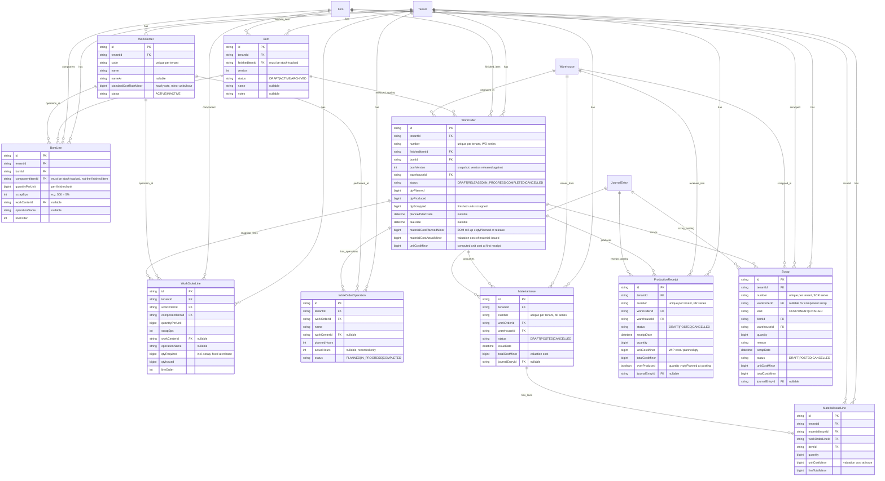

# EsERP Phase 7 — Manufacturing ERD

Source of truth: `packages/db/prisma/schema.prisma` (migration
`0009_phase7_manufacturing`; RLS policies in
`packages/db/prisma/rls.sql`). Conventions as Phase 0–6: every table's
`id` is `String @id @default(uuid(7))`; every tenant-scoped table
carries `tenantId`, `createdAt`, `updatedAt`, `createdBy` and a
`@@index([tenantId])`. Money is integer minor units (`BigInt`) +
currency code — never floats. Quantities are `BigInt`. Scrap % is
stored in basis points (`Int`, e.g. 500 = 5%).

## New tables



## Constraints, indexes, and RLS per table

RLS policy (all ten tables): `tenant_isolation`
`USING ("tenantId" = current_setting('app.tenant_id', true) OR
current_setting('app.bootstrap', true) = 'eserp-login')` with the same
`WITH CHECK`, plus `FORCE ROW LEVEL SECURITY` — identical to Phase 0–6.

| Table | Key constraints | Indexes | RLS |
| --- | --- | --- | --- |
| WorkCenter | PK `id`; UK `(code, tenantId)` | `tenantId`, `status` | `tenant_isolation` |
| Bom | PK `id`; UK `(finishedItemId, version, tenantId)`; FK `finishedItemId` (Restrict) | `tenantId`, `finishedItemId`, `status` | `tenant_isolation` |
| BomLine | PK `id`; FK `bomId` (Cascade), `componentItemId`/`workCenterId` (Restrict) | `tenantId`, `bomId`, `componentItemId` | `tenant_isolation` |
| WorkOrder | PK `id`; UK `(number, tenantId)`; FK `finishedItemId`/`bomId`/`warehouseId` (Restrict) | `tenantId`, `finishedItemId`, `bomId`, `warehouseId`, `status` | `tenant_isolation` |
| WorkOrderLine | PK `id`; FK `workOrderId` (Cascade), `componentItemId`/`workCenterId` (Restrict) | `tenantId`, `workOrderId`, `componentItemId` | `tenant_isolation` |
| WorkOrderOperation | PK `id`; FK `workOrderId` (Cascade), `workCenterId` (Restrict) | `tenantId`, `workOrderId` | `tenant_isolation` |
| MaterialIssue | PK `id`; UK `(number, tenantId)`; FK `workOrderId`/`warehouseId` (Restrict), `journalEntryId` (SetNull) | `tenantId`, `workOrderId`, `warehouseId`, `status` | `tenant_isolation` |
| MaterialIssueLine | PK `id`; FK `materialIssueId` (Cascade), `workOrderLineId`/`itemId` (Restrict) | `tenantId`, `materialIssueId`, `itemId` | `tenant_isolation` |
| ProductionReceipt | PK `id`; UK `(number, tenantId)`; FK `workOrderId`/`warehouseId` (Restrict), `journalEntryId` (SetNull) | `tenantId`, `workOrderId`, `warehouseId`, `status` | `tenant_isolation` |
| Scrap | PK `id`; UK `(number, tenantId)`; FK `workOrderId` (Restrict), `itemId`/`warehouseId` (Restrict), `journalEntryId` (SetNull) | `tenantId`, `workOrderId`, `itemId`, `status` | `tenant_isolation` |

## Flows

```
WorkCenter (code, hourly rate)
  └─▶ Bom (DRAFT → ACTIVE; one ACTIVE version per finished item)
        └─▶ WorkOrder (DRAFT)
              └─▶ release → snapshots BOM lines to WorkOrderLine
              │     (qtyRequired = ceil(qtyPerUnit x (1 + scrap) x qtyPlanned))
              │     materialCostPlannedMinor = roll-up x qtyPlanned
              ├─▶ MaterialIssue (DRAFT → POSTED)
              │     • stock OUT at valuation cost (FIFO/weighted/standard)
              │     • WO line qtyIssued +=, materialCostActualMinor +=
              │     • WO → IN_PROGRESS; JE Dr 1220 / Cr 1210
              ├─▶ ProductionReceipt (DRAFT → POSTED)
              │     • stock IN at computed unit cost
              │     • qtyProduced +=; overProduced flag when > planned
              │     • JE Dr 1230 / Cr 1220
              ├─▶ Scrap (DRAFT → POSTED)
              │     • COMPONENT: stock OUT, JE Dr 5260 / Cr 1210
              │     • FINISHED: JE Dr 5260 / Cr 1220 at WO unit cost
              └─▶ complete → cost-variance summary
                    (planned vs actual material cost)
```

## Costing rules

- **BOM roll-up (computed, never stored)** — `bomStandardCost()` in
  `packages/shared/src/manufacturing.ts`:
  `standardCost = Σ component.standardCostMinor × quantityPerUnit ×
  (1 + scrapBps / 10_000)`, half-up integer division. A later
  standard-cost change re-rolls the BOM. `GET /manufacturing/boms/:id/cost`
  returns the roll-up + per-line costs.
- **BOM snapshot at release** — the BOM lines are copied to
  `WorkOrderLine` with `qtyRequired` (incl. scrap, rounded up via
  `requiredQty()`). Later BOM edits never rewrite a released order's
  history. `materialCostPlannedMinor = roll-up × qtyPlanned`.
- **Receipt unit cost** — at the first receipt,
  `unitCostMinor = (materialCostActualMinor if > 0 else
  materialCostPlannedMinor) / qtyPlanned` (integer division). Later
  receipts reuse the same unit cost. The finished-goods stock layer is
  valued at that unit cost.
- **Over-production** — receiving more than `qtyPlanned` is allowed;
  the receipt is flagged `overProduced = true` (warning, not an error).
- **Material issue cap** — a line may not issue more than
  `qtyRequired − qtyIssued` (400 otherwise). The issue is valued at
  the item's valuation cost at issue time (FIFO layers first).
- **WIP balance** (per open work order, `GET /manufacturing/reports/wip`):
  `WIP = material issued − production received − finished scrap`
  (all in minor units). Completion % = `qtyProduced / qtyPlanned × 100`.
- **Completing with remaining WIP** leaves the balance on the order —
  no automatic write-off. The complete response carries a
  cost-variance summary: `plannedMaterialCostMinor`,
  `actualMaterialCostMinor`, `varianceMinor = actual − planned`.

## Posting mappings (Saudi CoA)

All postings go through `PostingService.postBalanced()` with
`sourceModule: 'MANUFACTURING'` and `reference` = the document number.
New CoA accounts added in Phase 7 (`saudi-coa.json`): **1220 Work in
Progress** (ASSET, parent 1200), **1230 Finished Goods Inventory**
(ASSET, parent 1200), **5260 Scrap Loss** (EXPENSE, parent 5200).
Existing: **1210 Inventory**.

| Event | Debit | Credit |
| --- | --- | --- |
| Material issue posted | 1220 WIP (issued valuation cost) | 1210 Inventory |
| Production receipt posted | 1230 Finished Goods (qty × unit cost) | 1220 WIP |
| Component scrap posted | 5260 Scrap Loss | 1210 Inventory (valuation cost) |
| Finished scrap posted | 5260 Scrap Loss | 1220 WIP (WO unit cost) |

**Labour is not posted in Phase 7.** `WorkOrderOperation.actualHours`
records hours only; labour cost posting is deferred to the Phase 8
payroll integration (documented limitation below).

## API

| Resource | Endpoints (`/api/v1`) | Permissions |
| --- | --- | --- |
| Work centres | `GET /manufacturing/work-centers`, `GET /:id`, `POST`, `PATCH /:id`, `DELETE /:id` (blocked when referenced) | `work-centers:read` / `work-centers:manage` |
| BOMs | `GET /manufacturing/boms`, `GET /:id`, `GET /:id/cost`, `POST`, `PATCH /:id`, `DELETE /:id` | `boms:read` / `boms:manage` |
| Work orders | `GET /manufacturing/work-orders`, `GET /:id`, `POST`, `PATCH /:id`, `POST /:id/release`, `POST /:id/complete`, `POST /:id/cancel`, `DELETE /:id` (DRAFT only), `PATCH /:workOrderId/operations/:operationId` | `work-orders:read` / `work-orders:manage` |
| Material issues | `GET /manufacturing/material-issues`, `GET /:id`, `POST`, `POST /:id/post`, `POST /:id/cancel`, `DELETE /:id` (DRAFT only) | `work-orders:read` / `work-orders:manage` |
| Production receipts | `GET /manufacturing/production-receipts`, `GET /:id`, `POST`, `POST /:id/post`, `POST /:id/cancel`, `DELETE /:id` (DRAFT only) | `work-orders:read` / `work-orders:manage` |
| Scrap | `GET /manufacturing/scrap`, `GET /:id`, `POST`, `POST /:id/post`, `POST /:id/cancel`, `DELETE /:id` (DRAFT only) | `work-orders:read` / `work-orders:manage` |
| WIP report | `GET /manufacturing/reports/wip?warehouseId=…` | `manufacturing:read` |

### Permissions (added to `ROLE_PERMISSION_MATRIX`)

New permissions: `manufacturing:*`, `work-centers:*`, `boms:*`,
`work-orders:*`.

| Role | Manufacturing access |
| --- | --- |
| OWNER / ADMIN | everything |
| ACCOUNTANT | `manufacturing:read`, `boms:read`, `work-orders:read`, `work-centers:read` |
| WAREHOUSE | `manufacturing:*`, `work-centers:*`, `work-orders:*`, `boms:read` |
| SALES / PURCHASING / HR | none (HR: none) |
| VIEWER | `*:read` (all read permissions) |

**Production role decision:** there is no dedicated PRODUCTION role.
The WAREHOUSE role doubles as the shop-floor/production role — it can
manage work centres, work orders, issues, receipts and scrap, and read
BOMs. This keeps the role matrix small and matches the demo tenant,
where warehouse staff run the packing line.

## Web UI

`/​[locale]/work-centers` — work-centre list + create form (code, name,
hourly rate).
`/​[locale]/boms` — BOM list with computed standard cost + create form
(finished item, version, component lines with qty + scrap % + work
centre); activate a DRAFT BOM.
`/​[locale]/work-orders` — work-order list + create form (finished
item → ACTIVE BOM → warehouse → qty), release / complete / cancel
actions, detail panel with lines (issued/required), operations,
planned vs actual cost, WIP balance and variance.
`/​[locale]/material-issues` — issue form (open work order → lines with
remaining quantities) + post / cancel.
`/​[locale]/production-receipts` — receipt form (open work order +
quantity) + post / cancel; over-production flagged.
`/​[locale]/scrap` — scrap form (work order, kind, item, qty, reason)
+ post / cancel.
`/​[locale]/wip-report` — per open work order: material issued,
production received, finished scrap, WIP balance, completion % (en/ar,
RTL).

## Seed

alsafa-trading demo (2026-11-24): item `GIFT-DATES-BOX` "Dates Gift
Box" (standard cost 16,050, sales 24,999); work centre `WC-PACK-01`
"Packing Line 1" (5,000/hr); BOM v1 ACTIVE (2× DATES-AJWA-400 with
500 bps scrap + 1× TEA-BLK-100 + 1× TISSUE-5PK; roll-up 16,050);
`WO-2026-00001` IN_PROGRESS (10 planned, 6 produced, 1 scrapped,
planned/actual material 160,500, unit 16,050);
`MI-2026-00001` POSTED 160,500 (Dr 1220 / Cr 1210);
`PR-2026-00001` POSTED 6 @ 16,050 = 96,300 (Dr 1230 / Cr 1220);
`SCR-2026-00001` POSTED finished 1 @ 16,050 (Dr 5260 / Cr 1220).
WIP balance 48,150, completion 60%. Component opening stock seeded
directly (dates 50→29, tea 30→20, tissue 20→10); gift box on hand
6 @ 16,050.

## Assumptions made

1. **BOM snapshot at release** (see Costing rules above) — a released
   order is immune to later BOM edits.
2. **Roll-up cost is computed, never stored** — re-rolled on every
   read from current component standard costs.
3. **Receipt unit cost = WIP cost incurred / planned qty** (actual if
   material was issued, else the planned roll-up) — a single unit cost
   per work order, fixed at first receipt.
4. **Over-production allowed with a warning flag** (`overProduced`),
   not blocked.
5. **Completing with remaining WIP leaves the balance** on the order;
   no automatic write-off to an expense account.
6. **WAREHOUSE role = shop-floor role** (see Permissions above).
7. **No MRP / auto-planning** — work orders are created manually
   (out of Phase 7 scope, per spec).

## Known limitations

- **Labour cost is not posted** — operations record planned/actual
  hours only; labour cost posting is deferred to Phase 8 payroll
  integration.
- No machine calendars, capacity planning, or routing sequences beyond
  the per-line work-centre/operation reference.
- No multi-currency manufacturing documents (tenant default currency
  only).
- Component scrap requires the item to be a work-order component when
  a work order is given; finished scrap requires the work order's
  finished item.
- Cancelling is only possible for DRAFT/RELEASED work orders with no
  posted documents; deleting only for DRAFT work orders.
