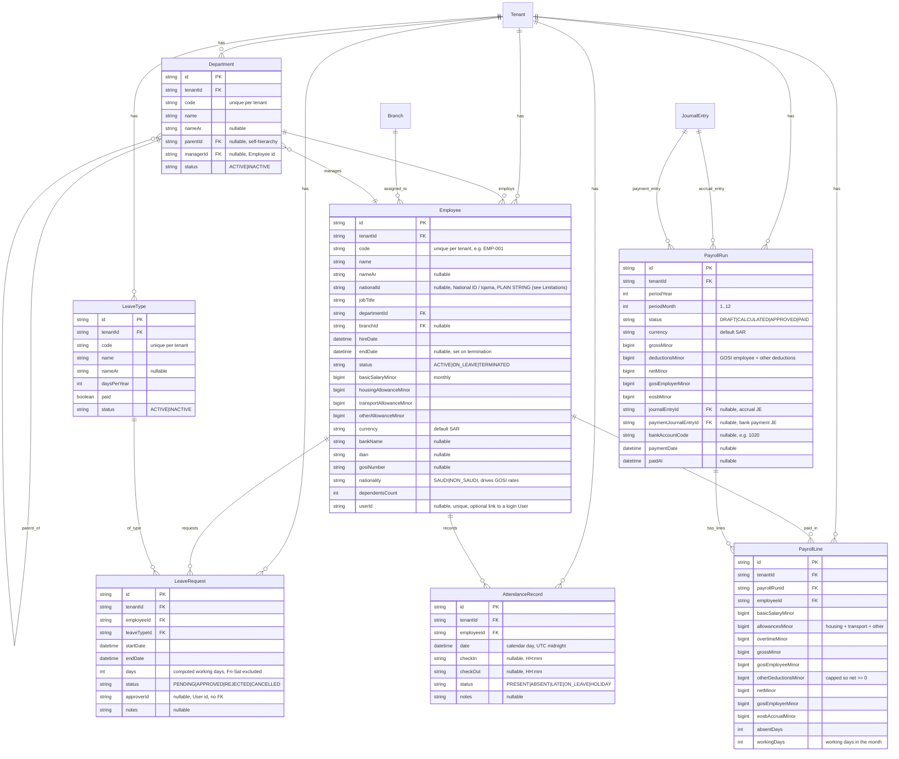

# EsERP Phase 8 — HR / Payroll ERD

Source of truth: `packages/db/prisma/schema.prisma` (migration
`0010_phase8_hr_payroll`; RLS policies in
`packages/db/prisma/rls.sql`). Conventions as Phase 0–7: every table's
`id` is `String @id @default(uuid(7))`; every tenant-scoped table
carries `tenantId`, `createdAt`, `updatedAt`, `createdBy` and a
`@@index([tenantId])`. Money is integer minor units (`BigInt`) +
currency code — never floats. All payroll math is half-up integer
division (`packages/shared/src/payroll.ts`).

## New tables



## Constraints, indexes, and RLS per table

RLS policy (all seven tables): `tenant_isolation`
`USING ("tenantId" = current_setting('app.tenant_id', true) OR
current_setting('app.bootstrap', true) = 'eserp-login')` with the same
`WITH CHECK`, plus `FORCE ROW LEVEL SECURITY` — identical to Phase 0–7.

| Table | Key constraints | Indexes | RLS |
| --- | --- | --- | --- |
| Department | PK `id`; UK `(code, tenantId)`; FK `parentId` (SetNull), `managerId` (SetNull) | `tenantId`, `parentId`, `managerId`, `status` | `tenant_isolation` |
| Employee | PK `id`; UK `(code, tenantId)`; UK `userId`; FK `departmentId` (Restrict), `branchId` (SetNull) | `tenantId`, `departmentId`, `branchId`, `status`, `nationality` | `tenant_isolation` |
| LeaveType | PK `id`; UK `(code, tenantId)` | `tenantId`, `status` | `tenant_isolation` |
| LeaveRequest | PK `id`; FK `employeeId`/`leaveTypeId` (Restrict) | `tenantId`, `employeeId`, `leaveTypeId`, `status`, `startDate` | `tenant_isolation` |
| AttendanceRecord | PK `id`; UK `(employeeId, date, tenantId)`; FK `employeeId` (Restrict) | `tenantId`, `employeeId`, `date`, `status` | `tenant_isolation` |
| PayrollRun | PK `id`; UK `(periodYear, periodMonth, tenantId)`; FK `journalEntryId`/`paymentJournalEntryId` (SetNull) | `tenantId`, `status`, `(periodYear, periodMonth)` | `tenant_isolation` |
| PayrollLine | PK `id`; UK `(payrollRunId, employeeId, tenantId)`; FK `payrollRunId` (Cascade), `employeeId` (Restrict) | `tenantId`, `payrollRunId`, `employeeId` | `tenant_isolation` |

## Flows

```
Department (code, hierarchy via parentId, optional manager)
  └─▶ Employee (code, department, branch, hire date, salary + allowances,
  │     nationality SAUDI|NON_SAUDI, IBAN, GOSI number)
  │     ├─▶ LeaveRequest (PENDING → APPROVED/REJECTED/CANCELLED)
  │     │     • days = working days (Fri–Sat weekend excluded)
  │     │     • approve enforces entitlement (approved + new ≤ daysPerYear)
  │     │     • overlap with PENDING/APPROVED → 409
  │     │     • LeaveBalance = entitlement − approved days taken (computed on read)
  │     ├─▶ AttendanceRecord (one per employee per day; bulk entry per day)
  │     │     • monthly summary: present/absent/late/on-leave/holiday
  │     └─▶ PayrollRun (DRAFT → CALCULATED → APPROVED → PAID)
  │           • calculate: one line per ACTIVE + ON_LEAVE employee
  │           • absent days deduct pro-rata basic (see Payroll rules)
  │           • approve locks the run (no further edits)
  │           • pay posts the accrual JE + the bank payment JE
  └─▶ Terminate employee → status TERMINATED + endDate (stays readable)
```

## GOSI (Saudi rules — verified 2026-11-24)

Rates used are the **existing scheme for employees first registered
before 3 July 2024** (sources: mercans.com, snad.io,
corporatestack.com, noblecoreksa.com, payrollmiddleeast.com). The
spec's numbers match this scheme exactly. The new-law step-up rates
for employees first registered on/after 3 July 2024 (10.75% employee /
12.75% employer from 1 July 2026, rising annually) are **out of
scope** — see Assumptions.

- **Contribution wage** = basic salary + housing allowance, capped at
  **SAR 45,000 / month** (`GOSI_WAGE_CAP_MINOR = 4_500_000`).
  The SAR 1,500 wage floor is **not** applied.
- **Saudi employee**: employee 9.75% (9% pension + 0.75% SANED),
  employer 11.75% (9% pension + 0.75% SANED + 2% occupational hazards).
- **Non-Saudi employee**: employer 2% occupational hazards only; no
  employee deduction.
- All percentages are in basis points in
  `packages/shared/src/payroll.ts` (`GOSI_SAUDI_EMPLOYEE_BPS = 975`,
  `GOSI_SAUDI_EMPLOYER_BPS = 1175`, `GOSI_NON_SAUDI_EMPLOYER_BPS = 200`),
  computed with half-up integer division on the capped wage.

## EOSB (Saudi Labour Law, art. 84)

- Monthly wage for EOSB = **basic salary + all allowances**
  (housing + transport + other).
- Accrual rate: **half a month's wage per year of service for the
  first 5 years**, **one month's wage per year thereafter**.
- Accrued monthly: `eosbAccrual = monthlyWage × factor / 12`,
  `factor = 0.5` while years of service < 5, else `1.0`. Service is
  measured in fractional years (`yearsOfService()`), so the factor
  switches at exactly 5 years.
- Posted to the EOS provision account on pay (Dr 5212 / Cr 2230).

## Payroll rules (`calculatePayrollLine()`)

For each line (employee ACTIVE or ON_LEAVE — paid leave still pays;
TERMINATED employees are excluded):

1. `workingDays` = working days (Sun–Thu) in the period month.
2. `absentDeduction = basic × absentDays / workingDays` (half-up).
   Absent days are counted from `ABSENT` attendance records in the
   month. **GOSI is computed on the full basic + housing (not reduced
   by absence); EOSB is computed on the full monthly wage.**
3. `gross = basic − absentDeduction + allowances + overtime`.
4. `gosiEmployee` / `gosiEmployer` per the GOSI section above.
5. `otherDeductions` (overrides) are **capped at gross − gosiEmployee**,
   so `net = gross − gosiEmployee − otherDeductions ≥ 0` always; the
   capped amount is what is stored and posted. This keeps the accrual
   journal entry balanced by construction.
6. Run totals are the sums of the lines.

## Leave rules

- **Weekend = Friday–Saturday** (Saudi week). `leaveWorkingDays()`
  counts only Sun–Thu days in the range; a request with 0 working days
  is rejected (400).
- **Balances are computed on read** (`GET /hr/leave-balances`):
  `balance = daysPerYear − approved days taken in the year` per leave
  type. Approval enforces `approved + new ≤ daysPerYear` (400 otherwise).
- Overlapping PENDING/APPROVED requests for the same employee → 409.

## Posting mappings (Saudi CoA)

Both entries are posted in one `pay` action via
`PostingService.postBalanced()` with `sourceModule: 'PAYROLL'`, dated
`paymentDate` (which must fall in an OPEN fiscal period), and
`reference` = `PAYROLL:<year>-<month>`. New CoA accounts added in
Phase 8 (`saudi-coa.json`): **2210 GOSI Payable**, **2220 Net Salaries
Payable**, **2230 End of Service Provision**, **2240 Other Payroll
Deductions Payable** (all LIABILITY, parent 2200); **5211 GOSI
Employer Contributions**, **5212 End of Service Benefits Expense**
(both EXPENSE, parent 5200). Existing: **5210 Salaries Expense**,
**1020 Bank** (default payment account; `bankAccountCode` is
overridable per pay action).

| Event | Debit | Credit |
| --- | --- | --- |
| Pay — accrual JE | 5210 Salaries Expense (total gross) | 2210 GOSI Payable (employee + employer) |
| | 5211 GOSI Employer Expense | 2220 Net Salaries Payable (total net) |
| | 5212 EOSB Expense | 2230 EOS Provision (total EOSB accrual) |
| | | 2240 Other Deductions Payable (if > 0) |
| Pay — payment JE | 2220 Net Salaries Payable | bank account (default 1020) |

Zero-value lines are skipped (e.g. no 2240 line when there are no other
deductions). The run requires ≥ 1 line to pay.

## API

| Resource | Endpoints (`/api/v1`) | Permissions |
| --- | --- | --- |
| Departments | `GET /hr/departments`, `GET /:id`, `POST`, `PATCH /:id`, `DELETE /:id` (blocked with employees or sub-departments) | `departments:read` / `departments:manage` |
| Employees | `GET /hr/employees`, `GET /:id`, `POST`, `PATCH /:id`, `POST /:id/terminate`, `DELETE /:id` (blocked with history — terminate instead) | `employees:read` / `employees:manage` |
| Leave types | `GET /hr/leave-types`, `GET /:id`, `POST`, `PATCH /:id`, `DELETE /:id` | `leave:read` / `leave:manage` |
| Leave requests | `GET /hr/leave-requests`, `GET /:id`, `POST`, `POST /:id/approve`, `POST /:id/reject`, `POST /:id/cancel` | `leave:read` / `leave:manage` |
| Leave balances | `GET /hr/leave-balances?employeeId=…&year=…` | `leave:read` |
| Attendance | `GET /hr/attendance`, `POST`, `POST /hr/attendance/bulk`, `GET /hr/attendance/summary?year=…&month=…&employeeId=…`, `PATCH /:id`, `DELETE /:id` | `attendance:read` / `attendance:manage` |
| Payroll runs | `GET /hr/payroll-runs`, `GET /:id`, `POST`, `POST /:id/calculate`, `POST /:id/approve`, `POST /:id/pay`, `DELETE /:id` (DRAFT only) | `payroll:read` / `payroll:manage` / `payroll:approve` |

### Permissions (added to `ROLE_PERMISSION_MATRIX`)

New permissions: `employees:*`, `departments:*`, `leave:*`,
`attendance:*`, `payroll:*`, `payroll:approve`.

| Role | HR / payroll access |
| --- | --- |
| OWNER / ADMIN | everything |
| ACCOUNTANT | `employees:read`, `departments:read`, `leave:read`, `attendance:read`, `payroll:read`, `payroll:approve` |
| HR | `employees:*`, `departments:*`, `leave:*`, `attendance:*`, `payroll:read`, `payroll:manage` (NOT `payroll:approve`) |
| WAREHOUSE / SALES / PURCHASING | none |
| VIEWER | `*:read` (all read permissions) |

**Role split (documented):** HR calculates the run
(`payroll:manage`); the Accountant approves and pays it
(`payroll:approve`) — payroll posting is an accounting action.

## Web UI

`/​[locale]/departments` — department list + create form (code, name,
parent, manager).
`/​[locale]/employees` — employee list + create form (code, name, job
title, department, branch, hire date, salary + allowances in SAR,
nationality, ID/Iqama, IBAN, bank, GOSI number); terminate action.
`/​[locale]/leave` — leave types (create + list), leave requests
(create + approve / reject / cancel), leave balances per employee per
year.
`/​[locale]/attendance` — bulk entry (one day, all employees with a
status each) + monthly summary table (present/absent/late/on-leave/
holiday, working days).
`/​[locale]/payroll-runs` — payroll run list + create form (year/month),
calculate / approve / pay actions, line detail (gross, GOSI employee/
employer, EOSB, other deductions, net, absent days) (en/ar, RTL).

## Seed

alsafa-trading demo (2026-11-24): departments `ADM` Administration
(manager EMP-001) + `OPS` Operations (manager EMP-002); 4 employees —
`EMP-001` Sara Al-Harbi (SAUDI, HR Manager, ADM, hire 2023-01-15,
basic 12,000 + housing 3,000 + transport 500, linked to the HR user
`hr@alsafa-trading.sa`), `EMP-002` Mohammed Al-Qahtani (SAUDI,
Warehouse Supervisor, OPS, hire 2022-06-01, 8,000/2,000/400),
`EMP-003` Rajesh Kumar (NON_SAUDI, Production Worker, OPS, hire
2024-03-01, 4,500/1,000/300), `EMP-004` Fatima Al-Anzi (SAUDI,
Accountant, ADM, hire 2021-09-01, 9,000/2,250/500); leave types
ANNUAL 30d paid, SICK 30d paid, UNPAID 0d unpaid; one APPROVED annual
leave for EMP-003, 2026-11-15→17 (3 working days); full November 2026
attendance — 88 records (4 employees × 22 working days, Fri–Sat
skipped; EMP-003 ON_LEAVE 15–17, EMP-002 ABSENT 10–11, EMP-004 LATE
9 Nov); payroll run November 2026 CALCULATED (not paid): gross
42,722.73, deductions 3,534.38, net 39,188.35, GOSI employer 4,369.38,
EOSB 2,300.00 (all SAR).

## Assumptions made

1. **GOSI = pre-3 July 2024 existing scheme** (see GOSI section):
   Saudi 9.75% employee / 11.75% employer; non-Saudi 2% employer only;
   wage = basic + housing, capped SAR 45,000/month; no SAR 1,500 floor.
   New-law step-up rates are out of scope.
2. **EOSB per Saudi Labour Law art. 84** (see EOSB section): half a
   month's wage per year for the first 5 years, one month per year
   thereafter; monthly wage = basic + all allowances; accrued monthly;
   factor switches at 5 years of service (fractional years).
3. **Absent days deduct pro-rata basic only**; GOSI and EOSB are
   computed on the full (unreduced) wage.
4. **Other deductions are capped** at gross − GOSI employee so net
   never goes negative (see Payroll rules).
5. **Payroll lines include ACTIVE + ON_LEAVE employees** (paid leave
   still pays); TERMINATED employees are excluded. Unpaid-leave
   deduction is out of scope.
6. **Weekend = Friday–Saturday** for leave working days and working
   days in the month.
7. **Pay posts accrual + bank payment in one action**; the payment
   date must fall in an OPEN fiscal period.
8. **HR calculates, Accountant approves/pays** (see Permissions above).

## Known limitations

- **National ID / Iqama is stored as a plain string** — field
  encryption is Phase 11 hardening scope, not Phase 8.
- No biometric / hardware attendance integration — attendance is manual
  entry or bulk entry only.
- No unpaid-leave pay deduction, no end-of-service settlement payout
  flow (EOSB is accrued as a provision only), no loans/advances.
- No multi-currency payroll documents (tenant default currency only).
- Terminated employees stay readable for history but are excluded from
  new payroll runs; deleting an employee with any leave, attendance or
  payroll history is blocked (terminate instead).
