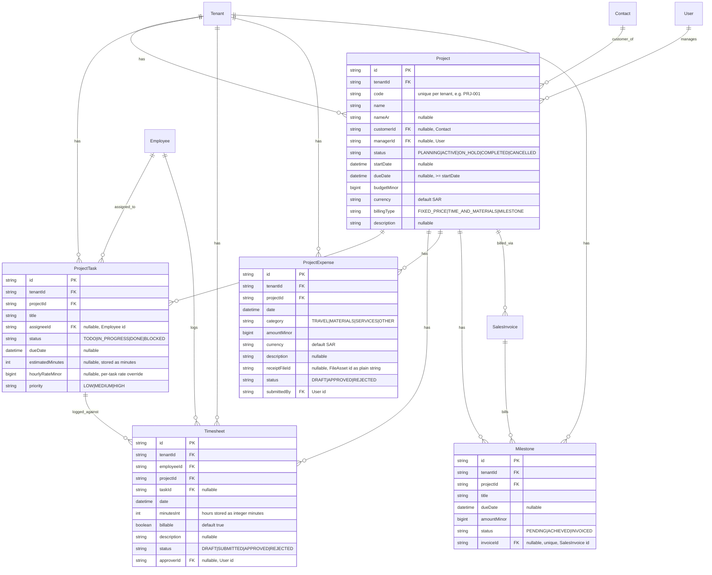

# EsERP Phase 9 — Projects ERD

Source of truth: `packages/db/prisma/schema.prisma` (migration
`0011_phase9_projects`; RLS policies in
`packages/db/prisma/rls.sql`). Conventions as Phase 0–8: every table's
`id` is `String @id @default(uuid(7))`; every tenant-scoped table
carries `tenantId`, `createdAt`, `updatedAt`, `createdBy` and a
`@@index([tenantId])`. Money is integer minor units (`BigInt`) +
currency code — never floats. All costing math is half-up integer
division (`packages/shared/src/projects.ts`).

## New tables

## Changes to existing tables

- `SalesInvoice` gained `projectId String?` + relation
  `ProjectInvoices` (optional link from any sales invoice to a project)
  and `@@index([projectId])`, plus the `MilestoneInvoice` relation for
  the milestone's invoice.
- `SalesInvoiceLine.itemId` became nullable and gained `description`:
  service/milestone lines have no stock item.

## Status rules

- `Project` status transitions are audited. `COMPLETED` and
  `CANCELLED` are terminal — a project cannot be reopened.
- `COMPLETED` locks time/expense entry: creating a timesheet or a
  project expense against a `COMPLETED` (or `CANCELLED`) project
  returns 409. Tasks and milestones on a completed project are
  read-only.
- `Timesheet` flow: `DRAFT → SUBMITTED → APPROVED | REJECTED`.
  Approval locks the entry (approved/rejected entries cannot be
  edited, only read). Approving a `DRAFT` directly is allowed.
  Deleting is allowed for `DRAFT` only.
- `ProjectExpense` flow: `DRAFT → APPROVED | REJECTED`. Only `DRAFT`
  expenses can be edited, approved, rejected or deleted.
- `Milestone` flow: `PENDING → ACHIEVED | INVOICED`. Update/delete
  only while `PENDING`.

## Costing formulas

All in `packages/shared/src/projects.ts` (`projectCosting()`), half-up
integer math, per-entry rounding.

- **Hourly cost rate** — `hourlyCostRateMinor(basicSalaryMinor) =
  basicSalaryMinor ÷ 160` (160 hours/month), half-up. This is the
  conservative, spec-implied formula: the employee's basic salary is
  the only cost input Phase 8 stores, and 160 h/month is the standard
  full-time month. A task's optional `hourlyRateMinor` override wins
  over the derived rate.
- **Timesheet hours** — the DTO takes decimal hours; the service
  converts with `hoursToMinutes` (decimal hours → integer minutes,
  rounded) and stores `minutesInt`. One entry per
  employee + project + task + date (unique index, plus a service-level
  duplicate check, because Postgres treats `NULL` taskIds as distinct
  in unique indexes). Multiple entries the same day are allowed only
  for different tasks.
- **Timesheet cost** — per entry: `timesheetCostMinor(minutes, rate) =
  minutes ÷ 60 × rate`, half-up, rounded **per entry**. Only
  `APPROVED` timesheets count towards labour cost and task actual
  hours.
- **Labour cost** — Σ approved timesheet costs (per-entry rate:
  task override, else employee basic ÷ 160).
- **Expenses** — Σ `APPROVED` project expenses, broken down by
  category. `DRAFT`/`REJECTED` expenses never count.
- **Materials** — `0` in Phase 9: there is no stock linkage from
  projects to inventory yet. The `MATERIALS` expense category is
  counted under expenses, not materials, so nothing is double-counted.
- **Revenue recognised** — Σ `SalesInvoice.totalMinor` where
  `projectId` is set and status is `POSTED | PARTIALLY_PAID | PAID`.
  `DRAFT` invoices are NOT recognised (by design: the seeded milestone
  invoice stays DRAFT, so seeded revenue is 0 until it is posted).
- **Profit** = revenue − actual; **margin** = profit ÷ revenue in
  basis points (null when revenue is 0); **burn rate** = actual ÷
  elapsed days; **projected total** = actual + burn rate × remaining
  days; **projected overrun** = max(0, projected total − budget).

## Milestone billing

Achieving a milestone on a `MILESTONE`-billed project creates a
**DRAFT** sales invoice via the Phase 3 service
(`SalesInvoicesService.createForMilestone`, same transaction — no
duplicated invoice logic): one service line (no item, description =
milestone title, qty 1, tax 0), amount = milestone amount, status
`INVOICED`, `invoiceId` set. On `FIXED_PRICE` / `TIME_AND_MATERIALS`
projects milestones are **tracking-only** (status `ACHIEVED`, no
invoice). Achieving a milestone on a `MILESTONE` project with no
customer, or with amount 0, returns 400. Milestone invoice amounts
are treated as net / VAT-exempt in Phase 9 (tax 0) — ZATCA
e-invoicing is Phase 11.

## Permissions

New permissions `projects:*`, `project-tasks:*`, `timesheets:*`,
`project-expenses:*`, `milestones:*` (see
`packages/shared/src/types.ts`): Owner/Admin full; Accountant read on
projects/tasks/timesheets/expenses/milestones; Sales read on
projects/tasks/milestones; HR read on timesheets; Viewer read-only.

## Seed

Demo project `PRJ-001` "Riyadh Trade Show Booth — Store Fit-Out"
(customer Al-Noor Retail, manager owner, `ACTIVE`, `MILESTONE`,
budget SAR 20,000, 2026-11-01 → 2026-12-15) with 2 tasks, 3 approved
timesheets (labour SAR 1,200), 1 approved `MATERIALS` expense
(SAR 1,500), milestone "Booth design approved" SAR 5,000 → `INVOICED`
with DRAFT invoice `INV-2026-00002`. Costing: actual SAR 2,700,
revenue 0 until the draft invoice posts.

## Assumptions

- The task assignee is an **Employee**, not a User (the spec left the
  choice open; employees carry the salary the costing formula needs).
- Hourly cost rate = basic salary ÷ 160 h/month (see above).
- Hours are stored as integer minutes; task estimated hours are
  stored as `estimatedMinutes`.
- Revenue is recognised only from posted/partially-paid/paid invoices
  linked by `projectId`.

## Limitations

- No stock/materials linkage in project costing (materials = 0).
- Milestone invoice amounts are VAT-exempt (tax 0); no ZATCA
  e-invoicing (Phase 11).
- No multi-currency project documents — single currency per project,
  tenant default.
- No background scheduler; costing is computed on read.
